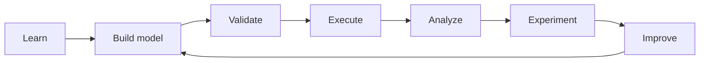
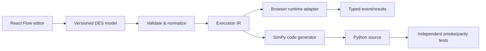
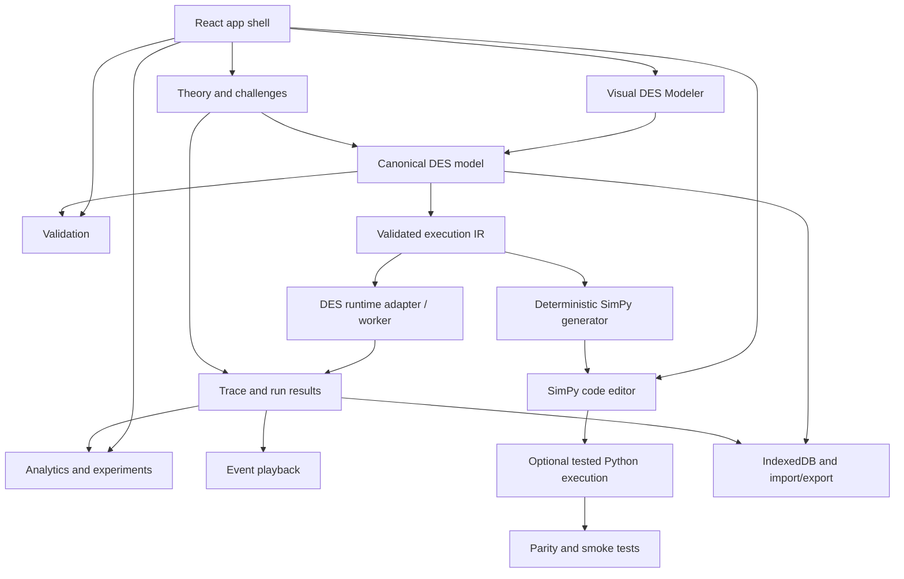

# DES Playground — PLAN.md

**Full name:** Interactive Discrete-Event Simulation Modeling, Experimentation and Learning Environment  
**Application type:** Interactive educational web application  
**Priority:** P1  
**Audience:** Undergraduate and graduate students in Modeling and Simulation, Business Process Management, Operations Research, Information Systems and related disciplines  
**Reference product:** BPMN Studio — pedagogical structure, modular architecture, validation, experimentation and design discipline  
**Companion:** [`STYLE.md`](STYLE.md) — original BPMN Studio visual language transferred to DES Playground  
**Status:** Upgrade specification, **not** a statement that all listed features are already implemented

> **Master instruction for Codex / Claude Code:** Read this plan, `STYLE.md` and the existing project `README.md`; inspect the repository before editing. Keep functioning React Flow editing, simulation, charts, theory and SimPy code generation. Introduce functionality in small, testable vertical slices. **Do not rebuild the project just to match the specification.** When current behavior differs from the README, document what actually exists and migrate safely.

---

# 1. Application overview

## 1.1 Confirmed scope from the uploaded README

The project's README is titled **“Discrete Event Simulation Python Code Generator.”** It reports these capabilities:

- A React 19 / TypeScript / Vite web application using Tailwind CSS and Lucide React icons.
- An `@xyflow/react` drag-and-drop **Source → Server → Sink** modeling canvas.
- Arrivals and service times configured with exponential, normal, uniform and custom distributions.
- An interactive simulation playground with results, charts and statistics using Recharts.
- Generation of executable Python simulation code targeting **SimPy**.
- A syntax-highlighted code editor using React Syntax Highlighter, with code export and an option to run generated code **if supported**.
- A theory section, introductory SimPy explanations and an M/M/1 example.
- A Google Generative AI integration associated with enhanced code generation.
- Export of generated code and simulation results.

**Important:** These are *README-reported* features; they are not evidence that numerical results, model semantics, generation correctness, persistence, security or browser-side Python execution have been validated. Phase 0 checks the implementation before any item is marked done.

## 1.2 Transfer map from BPMN Studio

| BPMN Studio pattern | DES Playground equivalent |
|---|---|
| Learn → Model → Validate → Simulate → Analyze → Optimize | **Learn → Model → Validate → Execute → Analyze → Experiment → Improve** |
| BPMN editor | DES node-and-edge modeler (sources, queues, service facilities, routing, sinks) |
| BPMN elements encyclopedia | DES component and queueing-theory encyclopedia with miniature examples |
| BPMN structural/semantic validator | Graph, distribution, event semantics, capacity and stability/feasibility validator |
| Animated token simulation | **Timestamped entity/event playback** generated from a real event trace |
| DES performance engine | Verified discrete-event engine / existing runtime adapter, separate from playback |
| Process performance dashboard | Queue lengths, waiting times, service times, WIP, throughput, utilization, loss |
| AS-IS vs. TO-BE | Baseline / alternative resource, routing and policy experiments |
| BPMN challenges | Queueing, distribution, routing, event-trace, calibration and improvement challenges |
| Standards and separate simulation data | Versioned DES model, experiment and result schemas; optional validated SimPy export |
| BPMN Studio style | Same exact palette, typography, geometry, compact shell and responsive principles |

**Do not import BPMN-only concepts** such as gateways, BPMN XML, pools/lanes, token-flow execution rules or `bpmn-js` into this product. DES uses entities, timestamped events, resources, queues and state changes. A diagram is an input representation—not automatically a correct simulation.

## 1.3 Vision

DES Playground must become more than a node editor or Python boilerplate generator. Students should be able to:

1. Understand the **event calendar, simulation clock, entities, resources, queues, distributions and performance metrics**.
2. Construct a DES model visually, with useful defaults and explicit assumptions.
3. Validate the model before running, and understand why a problem matters.
4. Step through **real, causally consistent events**, rather than watching decorative animation.
5. Inspect queue dynamics, resource utilization and individual entity journeys.
6. Configure repeatable runs with declared random seeds, termination criteria and warm-up policy.
7. Compare scenarios statistically, not just compare two unreplicated chart lines.
8. Generate readable **SimPy** source that represents the supported model faithfully.
9. Complete guided lessons, debugging tasks and practical challenges.
10. Export model definitions, run metadata, event traces, CSV results and Python code.

## 1.4 Core learning cycle



### Student success story

A student opens the **M/M/1 queue** example, sees what λ and μ mean, changes mean interarrival/service times, validates the stability assumptions, steps through an arrival and departure, runs multiple independent replications, interprets queue waiting and server utilization, compares a second-server alternative, and exports a SimPy script that reproduces the model's intended behavior. The entire workflow must be possible without leaving the app.

## 1.5 Modeling language and scope boundaries

**Core DES constructs (P1):** `Source`, `Queue`, `Server`, `Sink`, `Router`, `Delay`, `ResourcePool`, `EntityClass`, plus directed entity-flow connections. `Queue` may initially be a visible subpart of a `Server` to preserve the current model format; introduce an explicit Queue node only after semantic rules are established. `Router`, `Delay` and `ResourcePool` are planned upgrades, not assumed current functionality.

**Advanced (P2/P3):** priority queues, resource schedules, reneging, balking, batching, failures/repairs, preemption, multistage service, multi-class arrivals, bounded buffers, multiple parallel outputs, resource sharing, networked queues. Each feature requires engine support, validator rules, playback and SimPy generator coverage before becoming selectable.

**Explicitly out of scope at first:** general BPMN execution, arbitrary Python execution as a trusted simulation substitute, arbitrary user-authored JavaScript evaluation, full animation physics, automated research-grade calibration and guaranteed support for every SimPy process pattern.

---

# 2. DES Playground — functional modules

## 2.1 Module A — Interactive DES Modeler

### Objective

Provide a standards-aware *conceptual* DES canvas using React Flow, with explicit translation to a typed, executable simulation model.

### Editor capabilities

- Drag-and-drop node palette, plus keyboard-accessible “Add component” flow.
- Create, connect, delete, duplicate and rename components; stable IDs independent of user-visible names.
- Undo/redo, zoom/pan, fit-to-view, minimap, selection/multiselect, align/distribute and keyboard shortcuts.
- Node inspector with description, parameter names, units, distributions, validation and examples.
- Context-sensitive connection handles that distinguish entity flow from configuration/reference links.
- Multiple models, autosave, duplicate as scenario, JSON import/export, and example gallery.
- Helpful blank state and onboarding that create a runnable Source → Server → Sink model.
- Interactive markers showing queue length and busy server count **only when simulation data exist**.
- Accessible semantics, clear focus outlines, complete light/dark themes.

### Component contracts

| Component | Basic parameters | Correct behavior |
|---|---|---|
| **Source** | entity class, interarrival distribution, start/end times, arrival limit | Schedules arrivals at nondecreasing simulation times; emits entities |
| **Queue** (planned explicit) | discipline, capacity, initial entities | Holds waiting entities; does not independently provide service |
| **Server / Service station** | parallel capacity `c`, service-time distribution, queue policy, optional linked resource | Seizes available server capacity, performs service, releases it, forwards entity |
| **Sink** | completion category, optional KPI tag | Records completed or rejected departures; terminal node |
| **Router / Decision** | probabilities or typed conditions | Selects supported outgoing path according to documented policy |
| **Delay** | delay distribution | Adds a non-resource holding time; does not imply busy server utilization |
| **Resource pool** | capacity, optional availability policy | Counts mutually shared units and enforces availability constraints |
| **Annotation / group** | title, note | Descriptive only; does not affect runtime semantics |

**Source→Server→Sink remains first-class**. Do not require students to insert separate queues when queueing can be represented by an appropriate station setting; surface queue state visibly.

### Visual network invariants

- `Source` has no incoming **entity-flow** edges; `Sink` has no outgoing entity-flow edges.
- The selected execution profile specifies which node types and number of outgoing paths are supported.
- No silently ignored disconnected processing nodes.
- Cycles are allowed **only if** routing/termination rules and progress behavior are understood and supported.
- No implicit entity splitting or joining; multiple outputs are not parallel branches unless explicitly modeled.
- Do not render a queue as physically empty if its runtime event state has waiting entities.
- Model positions, styles and panel layout never become the source of queueing semantics.

### Contextual help examples

- **Source:** Interarrival time is the interval between successive arrivals, not the arrival rate. Distinguish `λ = 0.2 arrivals/minute` from a mean interarrival time of `5 minutes`.
- **Server:** Capacity 2 means two simultaneous service channels, not twice the speed of one channel unless the experiment changes service rates.
- **Queue:** Waiting time ends on service start. “Queue length” normally excludes entities currently in service; make inclusion rules explicit.
- **Sink:** A sink counts completions, not necessarily all arrivals if the horizon stops mid-process.

### Acceptance criteria

- A user can create, save, reopen and correctly run a Source→Server→Sink model.
- Model IDs, links, distribution parameters and scene positions survive a save/load cycle.
- Invalid connections are prevented or explicitly rejected with feedback.
- Every visible executable component has a defined mapping to the engine and SimPy exporter, or an obvious “not yet supported” state.

---

## 2.2 Module B — DES Learning Mode and Theory Hub

### Objective

Turn the existing theory section into progressive, interactive learning integrated with the modeler and analytics.

### Learning levels

**Level 1 — DES foundations**: simulation vs. optimization, state, entities, events, virtual simulation time, event scheduling, process interactions and termination.  
**Level 2 — Arrivals and distributions**: deterministic/exponential/uniform/normal, sampling, independence, parameters vs. rates, negative-duration policies and random seeds.  
**Level 3 — Queues and resources**: FIFO, waiting vs. service, M/M/1, M/M/c, ρ, bottlenecks, queue discipline and capacity.  
**Level 4 — Event mechanics**: priority queue, simultaneous events, arrival/departure/route ordering, event traces and state invariants.  
**Level 5 — Output analysis**: WIP, throughput, utilization, Little's Law, time-weighted vs. entity-weighted metrics, confidence intervals.  
**Level 6 — Experimentation**: warm-up, independent replications, common random numbers, scenario fairness, sensitivity, variance reduction.  
**Level 7 — Code and reproducibility**: visual DES-to-SimPy mapping, independent validation, export/re-execution, limitations.

### Lesson template

Each concept page contains:

1. Concept explanation (brief, nontechnical language first).
2. Annotated miniature queue/process diagram.
3. “Change one thing” interactive demonstration with reset.
4. Inspectable event timeline with time and state.
5. Typical misunderstanding and why it is wrong.
6. Micro-challenge plus hint and feedback.
7. “Open in modeler” action with a working example.

### Essential interactive micro-lessons

- **Events vs. animation frames:** the clock jumps to the next *scheduled* event, even if no real-time second passes.
- **Arrival rate vs. mean interval:** explain the reciprocal relationship with consistent units.
- **Service vs. wait:** a busy server and a waiting queue represent different states.
- **Queue stability:** demonstrate near-saturation and transient/finite-horizon limitations.
- **Resource contention:** add a second server and observe resource utilization and queue response.
- **Randomness:** replay the same model with one seed, then change seed to explain sampling variability.
- **Warm-up:** demonstrate why an empty-start run may bias steady-state estimates.
- **Little's Law:** compare time-average L, measured throughput λ_eff and entity-average W under clearly stated observation assumptions.

### Progress and pedagogy

Persist lesson completion and attempts locally; badges are optional. Hints should be progressive, and grades should not be based solely on the graph's visual layout. Explain *why* a student has a misconception.

---

## 2.3 Module C — DES Validator

### Objective

Identify structural, parameter, statistical and runtime-semantic problems **before** a simulation is presented as meaningful.

### Validation tiers (keep separate)

1. **Schema and structural correctness:** valid model JSON, identifiers, ports and edges.
2. **Semantic executability:** every executable node, routing policy and resource behavior supported by the current engine.
3. **Parameter correctness:** distribution parameterization, constraints, units and horizon.
4. **Statistical/experimental warnings:** possible instability, unreliable sample size or insufficient warm-up.
5. **Educational recommendations:** clarity, modeling assumptions, unnecessary complexity.

### Required checks

| Category | Examples | Severity guidance |
|---|---|---|
| Structure | missing Source/Sink, unreachable nodes, incompatible edges, invalid topology | Error |
| Parameters | nonpositive exponential mean, negative uniform bounds, `min > max`, `capacity < 1`, nonfinite values | Error |
| Distribution | unspecified normal truncation/resampling policy; custom distribution lacks supported sampler | Error or warning by execution profile |
| Routing | probabilities not summing to 1 (within declared tolerance), missing branch, unsupported feedback loop | Error |
| Units | arrivals/minute vs. service time in hours; mismatched model clock units | Error or warning with remedy |
| Simulation | horizon ≤ 0, conflicting stop conditions, unbounded zero-delay event chain | Error |
| Feasibility | obvious arrival overload `λ ≥ cμ` in supported steady-state queue model | Warning, not blanket invalidation |
| Export | visual feature not representable in generated SimPy target | Error for “Export runnable equivalent” |
| Statistics | 1 replication with implied precision, comparing different warm-ups, no evidence of convergence | Recommendation/warning |
| Accessibility | unlabelled node, ambiguous metric and unit, tiny unreadable labels | Recommendation |

**Stability note:** `ρ = λ/(c μ)` is valid for the classic M/M/c interpretation, with matching rate units. `ρ ≥ 1` warns of no finite steady-state under that model's assumptions. It does not invalidate a finite-horizon or intentionally overloaded scenario.

### Validation feedback shape

```ts
type Severity = 'error' | 'warning' | 'recommendation' | 'info';
interface ValidationIssue {
  id: string;
  severity: Severity;
  category: 'structure' | 'semantic' | 'parameter' | 'units' | 'statistics' | 'export';
  nodeId?: string;
  edgeId?: string;
  field?: string;
  title: string;
  explanation: string;
  consequence: string;
  suggestedFix?: string;
  lessonId?: string;
}
```

### Severity and interaction

- **Error:** cannot run or cannot claim equivalent export; show affected control, actionable fix and link to inspector.
- **Warning:** run may proceed, but results require caution; make visible in results metadata.
- **Recommendation:** pedagogical improvement, not a hard failure.
- **Information:** explanatory note, assumptions or simulation scope.

Do not report nontermination, deadlock or statistical invalidity as a proven fact without a justified analysis. A syntactically valid DES diagram can still be an unsupported or meaningless simulation model.

### Acceptance criteria

- Invalid source/service parameters cannot produce a misleading chart.
- Clicking a validation row focuses the implicated node, field or edge.
- Unsupported constructs are not silently dropped by the engine or exporter.
- Warnings are preserved in exported run metadata when scientifically relevant.

---

## 2.4 Module D — Event Simulation Engine and Playback

### Objective

Run a correct discrete-event model with explicit virtual time, then visualize a **trace of that execution**.

### Crucial separation

**Simulation engine:** creates timestamps, state transitions and metrics.  
**Playback UI:** consumes a recorded event trace and renders the model state at a selected event/time.  
**Generated Python:** an additional executable representation that must be tested for **semantic parity**.

Do **not** implement simulation as `setInterval` moving circles between nodes, do not derive results from animation FPS, and do not treat browser wall-clock speed as simulated time.

### Engine minimum requirements

- Future-event calendar ordered by `(simulatedTime, eventPriority, insertionSequence)` with deterministic tie policy.
- Monotonic simulated clock, explicit time unit and no backward scheduling.
- Stable event and entity IDs; entity-specific arrival/service/wait/departure history.
- Event types: `ARRIVAL`, `QUEUE_ENTER`, `SERVICE_START`, `SERVICE_END`, `DEPARTURE`, with supported `ROUTE`, `RESOURCE_REQUEST`, `RESOURCE_RELEASE` as needed.
- Server capacity and queue discipline respected on all transitions.
- Correct handling of multiple same-time events; documented priority and FIFO fairness.
- Explicit behavior for zero-duration services/arrivals, cancellation and maximum events at one timestamp to prevent frozen UI.
- Stop policies: horizon, entity completion count, max events; unfinished entities separately accounted for.
- Seeded, reproducible PRNG (if JS runtime is used); saved random stream metadata.
- Local worker execution for large simulations with cancellation and progress; no long-running loop on the UI thread.
- Full trace for small teaching runs; bounded or sampled trace for large runs with honest disclosure.

### Runtime strategy — decision after audit

**Option A (preferred when current browser engine is correct):** keep a TypeScript DES engine in a Web Worker, with a typed trace/results API. Generate SimPy as a separate adapter from the same canonical model. Verify key invariants and aggregate parity against SimPy references.

**Option B (if app currently executes Python):** run a constrained, generated SimPy model in a Python environment, return typed trace/results to React, and ensure the runtime cannot access arbitrary secrets. Browser Pyodide/Web Worker is a separately assessed option; loading a Python distribution and SimPy may increase bundle/network cost and **does not automatically make arbitrary user code safe**.

**Do not build two unrelated simulation definitions.** Both engine and exporter must compile from one model contract. Choose one execution authority per run and show its identity in results.

### Simulation controls

- Validate → Run, Pause playback, Resume playback, Stop playback, Reset, Step event, Back event, Jump to time/event, Speed control.
- Distinguish **run complete** from **playback in progress**; pause animation need not pause an already completed simulation calculation.
- Playback: animate entity movement and server/queue state only between actual trace transitions.
- Selection: click entity → inspect arrival time, queue wait, service start, service duration, route and outcome.
- Event inspector: timestamp, event type, entity ID, node, affected resources, queue length, cause and next scheduled event if available.
- Run reproducibility card: model hash/version, engine version, seed, horizon, warm-up, units and limits.

### State invariants

At any event boundary:

- `0 ≤ busyServers ≤ serverCapacity` for each station.
- `queueLength ≥ 0` and respects any capacity constraint.
- Each active entity is in a defined state and cannot simultaneously occupy mutually exclusive states.
- For a closed accounting scope, `arrivals = completions + losses + inSystem` (adjust for intentional external inflows, source distinctions and cutoffs).
- Service start cannot occur before entity arrival or queue entry.
- `departureTime ≥ arrivalTime`; nonnegative wait/service/sojourn times.
- Completed throughput and WIP must match recorded lifecycle events.

### Acceptance: manually inspectable timeline

For a deterministic single-server model with arrivals at `t = 0, 1` and constant service time `2`:

| Time | Event | Expected behavior |
|---:|---|---|
| 0 | Arrival A, service start A | Server busy; queue length 0 |
| 1 | Arrival B | B waits; queue length 1 |
| 2 | Completion A, start B | A departs; B leaves queue, server remains busy |
| 4 | Completion B | B departs; server idle |

Exact event log rows depend on the documented same-timestamp tie order; **state and timing must be correct**.

---

## 2.5 Module E — DES Performance Simulation and Analytics

### Objective

Provide scientifically interpretable metrics, not only attractive charts.

### Core run parameters

| Parameter | Requirements |
|---|---|
| Time unit | seconds/minutes/hours; canonical unit per model, explicit conversion |
| Horizon | finite simulated time, optional drain-to-empty policy explicitly named |
| Start condition | empty by default; optionally seeded initial WIP if model supports it |
| Warm-up | simulated time excluded from estimators as defined; document cohort handling |
| Replications | independent seeds / streams, explicit `n`, default modest classroom setting |
| Random seed | base seed plus documented per-replication derivation |
| Trace mode | full, sampled, summary-only based on estimated memory |
| Completion target | optional entity count, with documented censored observations |
| Safety guard | max events, max WIP, max same-timestamp events, cancellation |

### Distributions and parameterization

- Deterministic / constant.
- Exponential with **mean** or **rate** made explicit and mathematically equivalent; reject nonpositive parameters.
- Uniform with ordered, nonnegative bounds when modeling durations.
- Normal with mean and standard deviation plus **explicit** nonnegative handling: rejection sampling (with cap), truncation or bounded transformation; do not silently clamp without reporting effects.
- Triangular (min, mode, max), lognormal (specified parameter convention), empirical samples and discrete weighted choice (later phases).
- Custom distributions only via a constrained, validated declarative format first; no unsafe expression evaluation.
- Different arrival classes and independent random streams (advanced).

### KPIs (each needs a documented denominator)

| Metric | Definition / display rule |
|---|---|
| Arrivals | Count of arrivals during the stated measurement interval |
| Completed | Entities departed by observation cutoff |
| In-system / WIP | Current count; for average use **time-weighted** area under WIP(t) divided by observation duration |
| Queue length | Current + maximum + **time-weighted** average of waiting entities, excluding in-service entities unless labeled |
| Waiting time Wq | Entity-average time from queue entry to service start for clearly defined cohort |
| Service time S | Entity-average active processing duration, excluding queue delay |
| Sojourn / system time W | Departure minus arrival, with explicit completed-cohort inclusion rules |
| Throughput | Completions per **simulated** time unit over specified observation window |
| Utilization ρ̂ | Integral of busy capacity / (available capacity × observation duration), adjusted for any capacity schedule |
| Loss / abandonment | Explicitly counted rejected, balked or reneged entities and rates |
| Resource idle time | Time-integrated available-but-unused capacity |
| Percentiles | e.g. P50/P90/P95 with method and cohort documented |
| Cost (later) | Wait, service, resource and rejected-entity costs only when input assumptions exist |

### Essential chart views

- Queue length vs. **simulation time** as **step curve**.
- Number of busy servers vs. time as step curve; maximum capacity overlaid.
- Completed count / cumulative departures vs. time.
- Waiting-time histogram or empirical CDF, with sample size.
- Time-weighted WIP and station utilization comparison.
- Per-entity timeline/Gantt-like intervals (teaching-sized runs).
- Flow/throughput over defined, explicit time bins (not per-frame FPS).
- Replication outcomes as dot/interval plots rather than obscuring variability.
- KPI cards, editable results table, download CSV and contextual “What does this mean?” explanations.

### Warm-up and endpoint rules

- Specify whether observation stops at the horizon or sources stop and the system drains; these yield different denominators and cohorts.
- Time-weighted measurements integrate piecewise-constant state over `[start, end]`, including the final partial interval.
- Entity-based waiting/sojourn summaries use a defined selection rule (arrived during interval, completed during interval, etc.); report censoring.
- Do not pool replications as if individual observations are all independent; CI for run performance should operate over replication estimators.
- Zero-count metrics display `N/A` with an explanation, not fake zeros.

### M/M/1 reference benchmarks (steady-state, assumptions mandatory)

For Poisson arrivals rate `λ`, exponential service rate `μ`, one FIFO server, infinite buffer/population, `0 ≤ λ < μ`:

\[
\rho = \frac{\lambda}{\mu},\qquad
W = \frac{1}{\mu-\lambda},\qquad
W_q = \frac{\lambda}{\mu(\mu-\lambda)},\qquad
L = \lambda W,\qquad L_q = \lambda W_q.
\]

Example: **mean interarrival 5 minutes** (`λ = 0.2/min`), **mean service 4 minutes** (`μ = 0.25/min`): `ρ = 0.8`, `W = 20 min`, `Wq = 16 min`, `L = 4`, `Lq = 3.2`. Treat these as **long-run reference values**, not guaranteed outcomes of one short stochastic run or cold-start simulation.

### Acceptance criteria

- Deterministic cases match hand-calculated expected times and queue lengths.
- Long-run stochastic benchmarks converge toward analytical queueing references within declared confidence/tolerance.
- Charts and summaries use the same event/run dataset and show units.
- Each number can be traced to a declared event cohort, averaging method and time interval.

---

## 2.6 Module F — Scenario Experimentation and Improvement

### Objective

Reproduce the BPMN Studio AS-IS / TO-BE experimentation experience with DES-specific rigor.

### Baseline → alternative workflow

1. Select a validated baseline model, seed policy, horizon, warm-up and replication plan.
2. Run a baseline experiment and freeze its version and run metadata.
3. Duplicate into an alternative (`TO-BE`) scenario without overwriting baseline.
4. Change exactly the intended variables: server capacity, service time, routing, queue policy, arrival load or working schedule.
5. Run under an explicitly comparable experiment design.
6. Compare metrics, confidence intervals, cost assumptions and trade-offs.
7. Record a student explanation of *why* the results differ.

### Experiment types

- **Capacity experiment:** 1 vs. 2 vs. 3 parallel servers.
- **Load sensitivity:** vary arrival intensity λ while holding service behavior fixed.
- **Service improvement:** reduce mean service time; weigh capacity/cost trade-offs.
- **Queue policy comparison:** FIFO vs. supported priority discipline.
- **Routing experiment:** change probabilities between parallel service stations.
- **Warm-up and horizon study:** demonstrate bias and convergence.
- **Distribution-shape experiment:** same mean, different variability.
- **Bottleneck relocation:** improve one station and investigate whether congestion moves.
- **Replicated sensitivity grid:** factorial/scenario sweep with bounded workload.

### Fair comparison and paired analysis

- Use equivalent measurement definitions and policies across scenarios.
- If using **common random numbers**, define separate stable streams for arrival/service/routing sources and align them deliberately; simply reusing a global seed does not guarantee correct pairing when model topology changes.
- Display deltas and uncertainty, not only a relative percentage.
- State whether lower is better (wait), higher is better (throughput), or context-dependent (utilization).
- Cost-benefit is optional and must be based on entered cost data rather than invented amounts.

### Comparison table

| Metric | Baseline | Alternative | Difference | Interpretation |
|---|---|---|---|---|
| Mean queue wait | Computed | Computed | Computed | Lower generally desirable |
| Mean sojourn time | Computed | Computed | Computed | Lower generally desirable |
| Throughput | Computed | Computed | Computed | Depends on demand and quality |
| Mean queue length | Computed | Computed | Computed | Lower often desirable |
| Utilization | Computed | Computed | Computed | High can signal congestion risk |
| Service cost | Input-derived | Input-derived | Computed | Only if modeled |
| Lost entities | Computed | Computed | Computed | Lower generally desirable |

### Acceptance criteria

- Baseline and alternative are immutable snapshots for a completed comparison.
- Model/configuration differences are visible.
- Metrics use identical definitions and comparable observation windows.
- Replicated experiment results expose variation and the seed/stream plan.

---

## 2.7 Module G — DES Challenges and Assessment

### Challenge types

1. **Build a queue:** model a bank counter, help desk or simple M/M/1 system.
2. **Fix a broken model:** find invalid distributions, missing sink, illegal routing or capacity conflicts.
3. **Predict the next event:** read a future-event calendar and identify the next event/state.
4. **Explain a waiting entity:** identify why service has not started.
5. **Compute by hand:** determine waiting/system time and utilization for a deterministic trace.
6. **Find the bottleneck:** distinguish high utilization from a proven long-term bottleneck.
7. **Compare policies:** choose an alternative based on replicated performance and stated costs.
8. **Diagnose a misleading plot:** detect endpoint bias or wrong averaging denominator.
9. **Match visual model to SimPy:** trace a `yield env.timeout(...)` or `Resource.request()`.
10. **Sensitivity study:** hypothesize, vary an input, compare evidence and interpret.

### Assessment principles

- Evaluate **semantics and behavior**, not exact canvas coordinates.
- Multiple graph arrangements may represent equivalent valid models.
- Use model invariants, expected traces, analytical references and explicitly stated scenario requirements.
- Separate structural correctness, numerical correctness and explanation quality.
- Provide progressive hints, specific errors and next learning content.
- The AI assistant may explain or suggest, but it must not be the sole grader for mathematically checkable answers.

### Challenge authoring contract

```ts
interface DesChallenge {
  id: string;
  version: number;
  title: string;
  difficulty: 1 | 2 | 3 | 4 | 5;
  objectives: string[];
  starterModelId?: string;
  task: string;
  constraints: Record<string, unknown>;
  referenceChecks: string[];
  hintSteps: string[];
  solutionExplanation: string;
}
```

---

## 2.8 Module H — Example Model Library

### Minimum curated examples

| Example | Teaches | Minimal expected outputs |
|---|---|---|
| Deterministic single server | clock, FIFO, event order | exact event trace, wait time |
| **M/M/1** | Poisson arrivals, exponential service, utilization | Wq, W, Lq, L vs. theory |
| **M/M/2 / M/M/c** | parallel capacity | queue wait/utilization shift |
| M/D/1 | variability effect | compare with M/M/1 |
| Help desk / ticket queue | arrivals, capacity, service levels | response/throughput |
| Supermarket checkouts | multiple queues or shared queue | wait vs. utilization |
| Healthcare triage | classes/priorities (when engine supports them) | class-dependent waiting |
| Production line | sequential stations | WIP and bottleneck |
| Call center | variable workload (advanced) | queue profile / abandonment |
| Computer/server processing | CPU jobs and queueing | turnaround and throughput |
| Faulty model gallery | diagnostics | validator explanation |

Each example needs a short narrative, learning objectives, defaults with units, documented assumptions, expected qualitative behavior, at least one challenge, and a tested model fixture. Do not advertise example capabilities before they are supported by the runtime.

---

## 2.9 Module I — SimPy Code Generation, Editor and Interoperability

### Objective

Retain the app's major differentiator—**visual model → executable SimPy Python**—while making output readable, reproducible and semantically trustworthy.

### Generate code from a canonical intermediate model



### Generated script expectations

- Clear imports (`simpy`, `random`, etc.), **documented required dependencies** and runtime version target.
- One `simpy.Environment` per replication, no global cross-run state leakage.
- Valid generator processes (`yield env.timeout(...)`, resource requests and releases) for supported components.
- Arrivals, resources, service, routing, termination, statistics and output observation policies generated from typed configurations.
- Stable human-readable Python function/variable names derived safely from node IDs.
- Safe escaping for labels and strings; no raw injection through user-provided names or descriptions.
- Distributions implemented with the declared parameter convention and nonnegative sampling policy.
- Readable comments mapping generated sections to visual node IDs.
- Emits structured data/CSV/JSON results with the same metric definitions as browser mode.
- An explicit header containing generator version, model version, intended Python/SimPy versions, time unit and configuration fingerprint.
- Formatting and linting where practical; generated scripts include a “how to run” note.

### Important: browser and Python are not magically bit-for-bit identical

Browser TypeScript and Python's `random` module do not necessarily share the same PRNG stream or event ordering. **Semantic equivalence** means equal model assumptions, constraints and definitions plus compatible statistical behavior. If exact trace parity is claimed, the app must implement a common PRNG/tie-order specification across both runtimes and prove it with tests.

### Generated vs. edited code

Maintain distinct states:

- **Generated from model:** reproducible view of canonical model; regenerate on model edits.
- **User-edited fork:** persistent editable Python source; show “Detached from visual model”.
- **Re-generate:** require an explicit action when it would replace user edits; preserve a backup or version.
- **Export:** provide `.py`, JSON model, CSV results and trace separately, with clear file provenance.
- Do not imply that editing Python automatically updates the React Flow diagram.

### Running Python in-browser (optional, gated)

The README says “Run Code” **if supported**. Investigate current implementation first. Options: generated, trusted model run in Pyodide within a **module Web Worker**; optional user-managed external Python execution; controlled backend only if explicitly added. Pin compatible Pyodide/SimPy versions and test package load time, size and offline behavior. Treat arbitrary user-edited Python as untrusted: browser workers alone are not a security boundary against all abuse. Require explicit warnings, resource limits or omit direct execution until a secure design is validated.

### AI-assisted generation (existing integration, enhance cautiously)

- Keep core code generation deterministic and **independent of AI**.
- AI may explain generated code, suggest a model, translate a natural-language scenario, or assist debugging.
- Always validate AI-suggested model JSON and generated code through the same validation/tests.
- Do not place API secrets in public frontend bundles; inspect how Google Generative AI is configured and use a secure server-side or user-owned key approach where appropriate.
- Explain external data transfer and ask before submitting private model data; provide a no-AI mode.
- No auto-execution of untrusted generated scripts.

---

# 3. DES Playground — technical architecture

## 3.1 Recommended technology stack (preserve before replacing)

| Layer | Primary technology | Strategy |
|---|---|---|
| App | React 19 + TypeScript + Vite | **Retain** existing app |
| Existing styling | Tailwind CSS | Apply BPMN Studio CSS design tokens and component recipes |
| Diagram | `@xyflow/react` | **Retain**, custom typed DES nodes and edges |
| Icons | Lucide React | Retain original BPMN Studio scale and strokes |
| Charts | Recharts | Retain, theme with CSS tokens and semantic units |
| Code display | React Syntax Highlighter | Retain unless performance/accessibility justifies a change |
| Code generation | Deterministic TypeScript compiler to SimPy | Refactor existing generator, do not replace with AI-only output |
| Simulation | Existing runtime, or verified TypeScript engine in Web Worker | Decide after Phase 0; enforce typed contract |
| Python execution | External SimPy baseline; optional pinned Pyodide | **Optional**; do not assume current availability |
| Model state | Existing state store (audit first); Zustand optional | Avoid duplicate authoritative model states |
| Persistence | IndexedDB + import/export JSON | Add if missing; local-first |
| Schema | TypeScript + Zod/JSON Schema or equivalent | Versioned and validated import |
| Unit/integration tests | Vitest + Testing Library | Add if missing |
| End-to-end | Playwright | Editor, simulation, export and accessibility smoke tests |
| Python generator tests | pytest, Python/SimPy smoke runner | Execute real exported scripts in CI when available |
| Build/deployment | Existing Vite deployment | Keep backend optional for basic teaching workflow |

**Version caution:** Pin and inspect actual installed versions in `package.json`/lockfiles rather than assuming these are present because they appear here. Verify import order of Tailwind and `@xyflow/react` styles against their installed major versions. Confirm third-party licenses.

### Official references (checked 2026-11-16)

- React Flow TypeScript usage: https://reactflow.dev/learn/advanced-use/typescript
- React Flow concepts: https://reactflow.dev/learn/concepts/building-a-flow
- SimPy basics and event semantics: https://simpy.readthedocs.io/en/stable/topical_guides/simpy_basics.html
- SimPy resources: https://simpy.readthedocs.io/en/stable/topical_guides/resources.html
- Pyodide package loading: https://pyodide.org/en/stable/usage/loading-packages.html
- Pyodide Web Workers: https://pyodide.org/en/stable/usage/webworker.html

## 3.2 Architecture principles

1. One **canonical semantic model** independent of diagram positions and visual components.
2. Domain boundaries for editor, validation, distribution sampling, events, results, experiments, code generation, pedagogy and storage.
3. **Never** derive simulated timestamps from UI frame intervals.
4. Deterministic event tie policy; seeded and documented random streams.
5. Explicit time units and metric denominators.
6. Features are enabled only when both simulation and export semantics exist, unless conspicuously labeled visualization-only.
7. Workers and bounded traces protect UI responsiveness.
8. Local-first model editing; no required login for core teaching.
9. Versioned data and migration with tested round-trips.
10. Reproducibility, accessibility, transparent assumptions and continuous testing.

## 3.3 Logical architecture



## 3.4 Core domain contracts — examples

The following are *proposed* contracts. Adapt to actual source code during Phase 0, preserve user data with migrations and avoid duplicating declarations in multiple folders.

```ts
type Id = string;
type TimeUnit = 'second' | 'minute' | 'hour';
type NodeKind = 'source' | 'queue' | 'server' | 'router' | 'delay' | 'sink' | 'resourcePool';
type Distribution =
  | { kind: 'constant'; value: number }
  | { kind: 'exponential'; mean: number }
  | { kind: 'uniform'; min: number; max: number }
  | { kind: 'normal'; mean: number; stddev: number; nonnegativePolicy: 'reject' | 'truncate' }
  | { kind: 'triangular'; min: number; mode: number; max: number }
  | { kind: 'lognormal'; muLog: number; sigmaLog: number }
  | { kind: 'empirical'; samples: number[] };

interface DesNode {
  id: Id;
  kind: NodeKind;
  name: string;
  config: Record<string, unknown>; // narrowed per node kind in final schema
  position?: { x: number; y: number }; // view-only, not simulation semantics
}
interface DesEdge {
  id: Id;
  sourceId: Id;
  targetId: Id;
  kind: 'entityFlow';
  routingWeight?: number;
}
interface DesModel {
  schemaVersion: number;
  id: Id;
  name: string;
  unit: TimeUnit;
  nodes: DesNode[];
  edges: DesEdge[];
  metadata?: { description?: string; createdAt?: string; updatedAt?: string };
}
interface RunConfig {
  horizon: number;
  warmup: number;
  replications: number;
  baseSeed: string;
  stopMode: 'atHorizon' | 'drainAfterArrivalsStop';
  maxEvents: number;
  maxSameTimestampEvents: number;
  traceMode: 'full' | 'sampled' | 'summary';
}
interface DesEvent {
  id: Id;
  t: number;
  seq: number;
  kind: 'arrival' | 'queueEnter' | 'serviceStart' | 'serviceEnd' | 'route' | 'depart' | 'reject';
  entityId: Id;
  nodeId: Id;
  resourceId?: Id;
  state?: { queueLength?: number; busy?: number; inSystem?: number };
}
interface RunRecord {
  id: Id;
  modelHash: string;
  modelSchemaVersion: number;
  engine: string;
  engineVersion: string;
  generatorVersion?: string;
  config: RunConfig;
  eventCount: number;
  warnings: ValidationIssue[];
  completedAt: string;
  metrics: Record<string, unknown>; // finalize with typed metric definitions
  trace?: DesEvent[];
}
```

### Schema refinements required before parallel implementation

- Replace `Record<string, unknown>` node config with a discriminated union (`SourceNode`, `ServerNode`, etc.) and Zod or JSON Schema validation.
- Define **distribution units**, random stream keys and JSON-safe serializable assumptions.
- Define a results type containing `value`, `unit`, `cohort`, `measurementWindow`, `estimator`, `sampleSize` and uncertainty where relevant.
- Use true event state snapshots or replayable deltas with a documented consistency contract. Store no mutable live objects in run records.
- Keep scenario overrides and UI layout in separate stores/records from immutable executed model snapshots.
- Build migration functions for each older schema version and fixture tests for legacy README-era models.

## 3.5 Event scheduler and statistics design

### Event calendar pseudocode

```text
on run initialize:
  validate canonical model
  normalize typed configs + units
  initialize seeded random streams and entity/resource state
  schedule source's first arrival event(s)

while calendar not empty and stop criterion not met:
  event = calendar.popMin(time, priority, insertionSequence)
  assert event.time >= clock
  integrate all time-weighted area metrics over [clock, event.time)
  clock = event.time
  apply event state transition using one authoritative state machine
  append trace event/snapshot if enabled
  schedule any new future events with deterministic ordering
  enforce zero-time loop, event-count and memory safety caps

finalize:
  integrate time-weighted metrics to measurement end
  reconcile entity accounting
  calculate metrics by explicit cohort and observation interval
  return immutable result and run metadata
```

### Engine/execution parity matrix

| Construct | TS runtime | SimPy generator | Validator | Playback | Test fixture |
|---|---|---|---|---|---|
| Source with constant interval | Required | Required | Required | Required | Required |
| Exponential interarrival | Required | Required | Required | Required | Required |
| Server c=1, FIFO | Required | Required | Required | Required | Required |
| Server c>1 | Required | Required | Required | Required | Required |
| Sink | Required | Required | Required | Required | Required |
| Router probabilities | Later | Later | Later | Later | Later |
| Priority / preemption | Later | Later | Later | Later | Later |
| Finite capacity/rejection | Later | Later | Later | Later | Later |
| Resource schedule | Later | Later | Later | Later | Later |

Do not enable a feature via its node palette until the relevant row is completely supported, unless clearly marked as a design-only prototype.

## 3.6 Recommended repository structure

```text
des-playground/
├── PLAN.md
├── STYLE.md
├── README.md
├── src/
│   ├── app/
│   │   ├── AppShell.tsx
│   │   ├── routes.ts
│   │   └── theme.tsx
│   ├── components/
│   │   ├── ui/
│   │   ├── des-nodes/
│   │   └── des-edges/
│   ├── features/
│   │   ├── modeler/
│   │   ├── properties/
│   │   ├── learning/
│   │   ├── validation/
│   │   ├── simulation/
│   │   ├── playback/
│   │   ├── analytics/
│   │   ├── experiments/
│   │   ├── challenges/
│   │   ├── examples/
│   │   └── code-generation/
│   ├── domain/
│   │   ├── model/
│   │   ├── distributions/
│   │   ├── events/
│   │   ├── resources/
│   │   ├── metrics/
│   │   ├── execution-ir/
│   │   └── schemas/
│   ├── workers/
│   │   ├── des.worker.ts
│   │   └── python.worker.ts        # optional, only when validated
│   ├── data/
│   │   ├── examples/
│   │   ├── lessons/
│   │   └── challenges/
│   ├── services/
│   ├── storage/
│   ├── hooks/
│   ├── utils/
│   └── styles/
│       ├── tokens.css
│       ├── global.css
│       ├── des-canvas.css
│       └── features.css
├── tests/
│   ├── fixtures/
│   ├── unit/
│   ├── integration/
│   ├── e2e/
│   └── generated-python/
├── docs/
│   ├── architecture/
│   ├── event-semantics/
│   ├── model-schema/
│   ├── metric-definitions/
│   └── teaching/
└── public/
```

**Do not blindly move source files.** Use this only as a target map; preserve repository-specific conventions and update imports/tests incrementally.

## 3.7 Persistence, provenance and data interchange

- Persist model snapshots, scene layout, simulation configuration, scenario overrides, learning progress, generated code forks and chosen run results as separate versioned objects.
- Use IndexedDB for nontrivial event traces; localStorage may hold tiny preferences only.
- Save run hash/version and avoid “phantom updates” where a chart reflects an older model while the canvas shows a newer one.
- On a model edit after a run, label results **“Out of date — rerun to update”** instead of silently claiming current results.
- Export/import native `.json` with schema version, semantic nodes, optional layout, distribution definitions and units.
- Export `.csv` for event trace and metrics; export `.py` for SimPy; include human-readable README/metadata where appropriate.
- Imported data must be validated and sanitized; support explicit migrations and backups.
- Avoid large unbounded traces in browser memory; implement retention/limits with user-visible settings.

## 3.8 Security and accessibility

- Avoid exposing external AI API keys in browser source or persisted project files.
- Do not use `eval`, `new Function` or arbitrary script execution for student expressions/distributions.
- Treat generated and edited Python as untrusted; no automatic execution on import.
- Sanitize node labels, tooltips, code-view markup, imported JSON and exported filenames.
- No server required for basic model editing, DES simulation and deterministic code generation.
- Screen-reader accessible node palette, inspector, simulation controls, validation and event table.
- Keyboard navigation for model editor, searchable command palette and skip-to-main link.
- High contrast, focus ring, non-color-only statuses, semantic chart labels/table alternatives, reduced motion and responsive reflow.

---

# 4. Development roadmap

All checkboxes are **initially unchecked** until the actual repository and acceptance evidence prove implementation. The README claims some capabilities; that is not a test result.

## Phase 0 — Audit and protection (mandatory first)

### Tasks

- [ ] Inspect `package.json`, routes, components, simulation logic, distribution functions, exporter and existing tests.
- [ ] Establish current run path: TypeScript simulation vs. browser Python vs. simulated/demo chart output.
- [ ] Audit Google Generative AI integration: use case, API-key placement, privacy and failure modes.
- [ ] Run install/build/typecheck/lint/tests and document baseline results.
- [ ] Exercise Source→Server→Sink and M/M/1 model manually; capture current outputs.
- [ ] Identify duplicated model states and conflicts between editor, simulation and code generator.
- [ ] Document supported distributions, parameter conventions, negative samples and unit handling.
- [ ] Audit chart statistic definitions, random seeds, simultaneous event behavior and stop conditions.
- [ ] Create regression fixtures / screenshots for working UX, code generation and exports.
- [ ] Establish feature support matrix and a small actionable technical-debt list.

### Acceptance

- Written baseline audit distinguishes **README claims**, implemented features, known defects and missing tests.
- Existing working usage remains intact after this phase.
- Technical strategy chooses a single canonical model and simulation authority.

## Phase 1 — Design system, shell and preservation

- [ ] Port exact BPMN Studio tokens, fonts, controls, borders, spacing and light/dark theme from `STYLE.md`.
- [ ] Build responsive app shell (232px/64px sidebar, 56px toolbar) using existing router/navigation where practical.
- [ ] Align Theory, Playground, Editor and Results navigation without hiding existing content.
- [ ] Create reusable Button, Input, Tabs, Card, Callout, KPI, Dialog, Inspector and Toast components.
- [ ] Theme React Flow nodes, handles, controls, minimap and Recharts consistently.
- [ ] Make component shapes and connection semantics legible in both themes.
- [ ] Add keyboard focus, accessible names, reduced-motion fallback and responsive inspector placement.

**Acceptance:** Existing editor, theory, charts, code generation and export still work; two-theme screenshot review at wide and narrow widths matches BPMN Studio's visual character.

## Phase 2 — Canonical model, distributions and validation

- [ ] Define versioned schema; map existing nodes/edges to the canonical DES model without data loss.
- [ ] Build typed Source/Server/Sink contracts and a semantic compiler to execution IR.
- [ ] Implement distribution schema and parameter/units validation with explicit nonnegative policies.
- [ ] Implement structural, graph, executability and export compatibility checks.
- [ ] Build validation issue panel and node-level contextual explanations.
- [ ] Add save/reopen, import/export, schema migrations and undo/redo regression tests.
- [ ] Add one full Source→Server→Sink vertical slice verified end-to-end.

**Acceptance:** Invalid graph/inputs cannot silently run; the same model schema drives editor, validation and generator; legacy model fixture round-trips.

## Phase 3 — Correct DES engine and event playback

- [ ] Add deterministic event calendar and documented simultaneous-event ordering in the chosen runtime.
- [ ] Add seeded distributions and stable resource queue behavior.
- [ ] Implement event trace, busy/queue/WIP state transitions and engine invariants.
- [ ] Add Web Worker, cancellation and event/memory safety guards where needed.
- [ ] Distinguish run computation from playback state.
- [ ] Add Play, Pause, Step, Back, Jump, Reset and time-scaled movement from actual event data.
- [ ] Add entity/event inspector, queue/busy overlays and timestamped event log.
- [ ] Test exact deterministic scenarios and statistical M/M/1 benchmarks.

**Acceptance:** Hand-checkable scenarios produce exact queue/service timelines; no animation advances simulated time independently of the event engine.

## Phase 4 — Simulation analytics and statistical output

- [ ] Document and implement entity-weighted vs. time-weighted metrics.
- [ ] Add queue/WIP/server timeline charts, utilization, throughput, waiting/system times and percentiles.
- [ ] Define measurement-window, warm-up, horizon/termination and censoring policies.
- [ ] Add independent replications with seed plans, confidence intervals and performance summary.
- [ ] Add results metadata, CSV export and table alternatives for charts.
- [ ] Add M/M/1 and M/M/c analytical-reference learning panels where appropriate.

**Acceptance:** Computed KPIs reconcile with traces; repeated runs are reproducible; long-run queues approach valid references with statistical tolerances.

## Phase 5 — Scenario comparison and experiments

- [ ] Clone model + configuration into immutable baseline/alternative snapshots.
- [ ] Build experiment configuration and side-by-side results page.
- [ ] Add capacity, arrivals, service-time and basic routing sweeps where supported.
- [ ] Compare replicated estimates and show uncertainty.
- [ ] Add provenance, model-difference view and interpretation prompts.
- [ ] Add a complete “Improve the help desk” teaching case.

**Acceptance:** Students can produce defensible baseline-vs-alternative reports without manual spreadsheet reconstruction.

## Phase 6 — SimPy generation parity, editor and safe optional execution

- [ ] Refactor generator to consume validated execution IR.
- [ ] Produce readable SimPy 4 scripts with correct distributions, resource usage and metric definitions.
- [ ] Add generator fixture/golden tests and Python execution smoke tests.
- [ ] Distinguish generated source from user-edited forks; protect unsaved changes.
- [ ] Export `.py` plus model/configuration/run provenance.
- [ ] Validate TypeScript↔SimPy semantic parity with deterministic fixtures and statistical tests.
- [ ] Evaluate Pyodide-worker execution feasibility; implement only if secure enough and performant.
- [ ] Improve AI explanations, with validation and key/privacy safeguards.

**Acceptance:** Exported code runs in a supported Python environment and represents the same model assumptions; unsupported constructs produce explicit export errors.

## Phase 7 — Educational content, examples and challenges

- [ ] Structure theory into progressive, contextual lessons with miniature executable examples.
- [ ] Add component encyclopedia and common error demonstrations.
- [ ] Ship deterministic queue, M/M/1, M/M/2, production line and other **supported** examples.
- [ ] Implement at least five assessed challenges with feedback and progressive hints.
- [ ] Add local progress and model-to-lesson deep links.
- [ ] Publish instructor notes and documented example assumptions.

**Acceptance:** Learners complete a guided task from lesson → model → validate → run → explain without instructor intervention.

## Phase 8 — Advanced DES extensions and release quality

- [ ] Add explicit Router and Delay semantics, validation, runtime, exporter and examples.
- [ ] Add optional finite queues, priority resource and multi-class entities as independent full vertical slices.
- [ ] Add optional resource calendars, abandonment, batching and interruptions only after model correctness tests.
- [ ] Optimize trace storage/virtualized event tables for larger teaching examples.
- [ ] Run accessibility audit, cross-browser tests and responsive screenshot review.
- [ ] Update README, architecture decisions, support matrix, limitations and license/attribution notes.

**Acceptance:** Each new construct passes modeler/runtime/validator/playback/export tests; unsupported constructs stay clearly unavailable.

---

# 5. Testing and scientific validation

## 5.1 Test pyramid

| Level | Tools / scope | Mandatory checks |
|---|---|---|
| Pure unit | Vitest | PRNG, distribution samplers, unit conversion, event order, queue invariants, metrics |
| Domain integration | Vitest | model compile → engine → trace → dashboard statistics |
| Generator | Golden/Python tests | Python syntax, SimPy imports, no injection, resources released, model fidelity |
| Statistical reference | Repeated seeded runs | M/M/1 stability/theory, CI trends, conservation; tolerance specified |
| UI integration | React Testing Library | edits, inspector, validation issue navigation, theme |
| E2E | Playwright | build an M/M/1 queue, save/load, run, step, compare, export |
| Accessibility | axe/manual keyboard | palette, editor alternatives, dialogs, charts/table equivalents |
| Visual regression | screenshots | light/dark, desktop/tablet, modeler, results, code editor |

## 5.2 Deterministic golden fixtures

1. **No arrivals:** metrics zero where defined; undefined averages shown `N/A`; no invented completions.
2. **One arrival / one server:** exact service start/end and queue empty.
3. **Two overlapping arrivals:** FIFO, wait time and busy state from the timeline in Module D.
4. **Parallel servers:** arrivals at same time occupy at most `c` servers; excess wait.
5. **Zero service time:** no illegal negative durations or infinite same-time event cycling.
6. **Out-of-order event attempt:** scheduler rejects negative/backward time.
7. **Finite horizon:** unfinished entities still counted as in-system at cutoff.
8. **Warm-up boundary:** time-weighted area and cohort selection handle the boundary exactly.
9. **Invalid topology:** disconnected node or illegal connection yields targeted validation error.
10. **Invalid distribution:** negative mean/NaN, wrong order or unsupported custom expression cannot run.
11. **Import round-trip:** old and new model layouts preserve semantics and IDs.
12. **Python parity:** deterministic single-server fixture matches SimPy output under equal event policy.

## 5.3 Statistical tests and reporting

- Test long-run M/M/1 and M/M/c systems under **documented assumptions** and statistically justified tolerances.
- Replicate with distinct seeds; verify a confidence interval is calculated from **replication-level** summaries.
- Regression tests must avoid flaky “exact stochastic mean” assertions.
- Verify chart/export totals sum to source event data and no sampling/truncation of traces silently changes computed metrics.
- Use performance budgets with representative models and max-event guardrails, not arbitrary unsafe infinite runs.
- Report convergence diagnostics rather than an unsupported “scientifically accurate” label.

## 5.4 Every feature's definition of done

- [ ] Scope and semantics documented, including what is *not* supported.
- [ ] Data contract and migrations updated if needed.
- [ ] Modeler and inspector complete in light and dark modes.
- [ ] Validation and educational feedback included.
- [ ] Runtime and event trace behavior correct where applicable.
- [ ] SimPy code generation/parity handled or feature explicitly disabled for export.
- [ ] Unit/integration/e2e tests included and passing.
- [ ] Keyboard/accessibility and responsive behavior reviewed.
- [ ] README, examples, implementation support matrix and relevant docs updated.
- [ ] No existing core flow regressed.

---

# 6. Development agents and collaboration

## 6.1 Suggested agents

**Agent 1 — Architecture and Integration**  
Owns canonical domain schema, feature gates, migration, app composition, architectural decisions and integration reviews.

**Agent 2 — DES Modeler and UX**  
Owns React Flow nodes, semantic edges, palette, inspector, editing commands, layout, saves and keyboard interactions.

**Agent 3 — Simulation Semantics**  
Owns event calendar, random streams, queue/resource state, run policies, trace capture, metrics invariants and worker execution.

**Agent 4 — SimPy Generator and Execution**  
Owns IR → Python compiler, typed generated/editable source, Python smoke/parity fixtures, guarded optional browser execution.

**Agent 5 — Learning and Challenges**  
Owns lessons, glossary, mini demos, examples, hints, evaluation rules and learning progress.

**Agent 6 — Analytics and Experiments**  
Owns Recharts, metric contracts, replications, confidence intervals, baseline/alternative comparison, CSV exports.

**Agent 7 — Testing and Design System**  
Owns BPMN Studio visual fidelity, accessibility, visual regression, e2e, CI and performance verification.

## 6.2 Collaboration rules

1. Phase 0 audit and shared interface decisions precede parallel coding.
2. Assign single ownership of model contracts, shared UI primitives and CSS tokens.
3. An agent changing an interface proposes changes before another agent consumes it.
4. Merge a working vertical slice rather than multiple half-wired modules.
5. Every supported node needs modeling, validation, runtime, playback, export and tests together.
6. Do not replace working code generation with AI-produced text.
7. Record assumptions, limitations and acceptance evidence, not only feature lists.
8. Do not label a feature “complete” merely because a UI control appears.
9. All work follows `STYLE.md`; avoid ad-hoc redesign and unsynchronized Tailwind colors.
10. Run build, tests and a representative example after each integration.

## 6.3 Master implementation prompt (copy into Codex / Claude Code)

> You are improving an existing **DES Playground** application, not creating a new repository.
>
> Read `README.md`, `PLAN.md` and `STYLE.md` and inspect the actual code before making changes. Use the proven **BPMN Studio** design language from `STYLE.md` exactly: cool neutral surfaces, compact navigation and inspector, blue primary actions, restrained orange simulation accents, 14px typography, 1px borders, small radii, consistent chart treatment and complete light/dark themes.
>
> Preserve existing React 19, TypeScript, Vite, Tailwind CSS, `@xyflow/react`, Recharts, syntax-highlighted editor, theory section, basic Source→Server→Sink simulation, and SimPy code generation wherever functional. Do not assume README claims are verified; audit them.
>
> Implement the DES learning cycle **Learn → Model → Validate → Execute → Analyze → Experiment → Improve**. Introduce a canonical versioned DES model used by editor, validator, simulation runtime and deterministic SimPy generator. Keep actual event simulation separate from animation/playback. Ensure documented time units, distributions, seeded reproducibility, queue/resource correctness, run metadata, time-weighted measurements, independent replications and meaningful warnings. Ensure Python exports correspond to supported visual constructs and treat user edits as detached forks.
>
> Start with Phase 0, then complete a Source→Server→Sink vertical slice with exact deterministic tests and M/M/1 benchmark tests. Only then expand to additional components and lessons according to the roadmap. Keep working functionality intact, add tests, retain readable code, document unsupported semantics and update the feature support matrix after each phase.
>
> Do not claim browser-side Python execution, SimPy parity, queue stability, numerical correctness or AI safety without evidence. If an implementation decision is uncertain, document it and choose the simplest correct solution that preserves current functionality.

---

# 7. Implementation priorities and exclusions

## Immediate P1

1. Audit and preserve existing functionality; fix correctness/security defects first.
2. Transfer BPMN Studio style and responsive shell consistently.
3. Canonical model + validator + typed distribution and units.
4. Correct single/parallel server DES with event-trace playback.
5. Scientifically meaningful KPIs and M/M/1 teaching benchmarks.
6. Deterministic SimPy generation with parity testing.
7. Scenario comparison, independent replications and guided learning.

## Later P2/P3

Priority classes, explicit queue nodes, routing probabilities, bounded buffers, delays, calendars, abandonment, shared resources, parameter sweeps, in-browser Python and richer examples—each as a complete tested vertical slice.

## Explicit no-go shortcuts

- Decorative “moving dots” presented as DES without event scheduling.
- Using one JavaScript interval per arrival as a substitute for a virtual-time event calendar.
- Averaging queue length per animation frame instead of time-weighting simulated state.
- Using one stochastic run as evidence for a significant scenario improvement.
- Pretending an unstable theoretical M/M/1 steady state is a simulation error.
- AI-generated Python that has not passed syntax, semantic and runtime tests.
- Missing API-key/privacy review for browser-side AI.
- Silent dropping of visual nodes from code generation.
- Replacing the whole app with a greenfield scaffold without a demonstrated reason.

---

# 8. Reference provenance

## User-provided sources

- `README(1).md`: current DES Playground README (the existing application's self-description).
- `PLAN(3).md`: BPMN Studio architecture, teaching, modules, roadmap and agent collaboration template.
- `STYLE(2).md`: BPMN Studio implemented design-language specification.
- Prior System Dynamics Studio adaptation demonstrates the expected format; this plan is tailored to **discrete-event** semantics, not continuous-time stock/flow simulation.

## Current technical references (checked November 2026)

- React Flow: https://reactflow.dev/learn/advanced-use/typescript
- SimPy event concepts: https://simpy.readthedocs.io/en/stable/topical_guides/simpy_basics.html
- SimPy resources: https://simpy.readthedocs.io/en/stable/topical_guides/resources.html
- Pyodide: https://pyodide.org/en/stable/ and https://pyodide.org/en/stable/usage/webworker.html

**Note:** This specification extrapolates beyond the uploaded README. All new components and numerical/statistical rules above are **proposals or acceptance criteria**, not claims that the repository already implements them. The implementation agents must confirm actual repository state and adjust the migration strategy accordingly.
