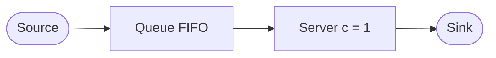

# DES Playground — STYLE.md

**Purpose:** Transfer the established **BPMN Studio design language** to the existing DES Playground application without replacing DES-specific modeling concepts.  
**Companion:** [`PLAN.md`](PLAN.md)  
**Applies to:** Application shell, Theory, Playground, Python Editor, DES canvas, Source/Server/Sink nodes, property inspector, validation, event playback, results, charts, experiments and challenges.  
**Source of visual truth:** the user-supplied BPMN Studio `STYLE(2).md`, not a new color theme.

> **Instruction for coding agents:** Treat this as a **visual and interaction specification**, not loose inspiration. Reproduce the actual BPMN Studio palette, typography, spacing, borders, component sizes, density, navigation proportions, light/dark behaviors and accessibility principles. Replace BPMN-only symbols with DES entities, resources, queues and event semantics. **Do not overwrite a working React Flow editor or Python code editor merely to imitate screenshots.** Audit current CSS/Tailwind before refactoring.

---

# 1. Visual character and design principles

DES Playground should feel like a **compact analytical learning workspace**, consistent with BPMN Studio and System Dynamics Studio. Visual style supports serious modeling, scientific experimentation and students' understanding of simulation behavior.

- **Keep the model prominent.** Canvas, code, event timeline and results take priority; navigation and utility panels form a quiet frame.
- **Density with structure.** Short controls grouped closely; stronger spacing between independent tasks and panels.
- **Neutral surfaces, thin borders.** Cool gray background, white/dark-slate elevated surfaces, subtle dividers and minimal shadows.
- **Blue means interaction.** Primary actions, selected nodes/rows, links and keyboard focus use the inherited primary blue.
- **Orange means active simulation or focused attention.** Use sparingly for the active event/time cursor; don't use as arbitrary permanent node fill.
- **Semantic status colors are contextual.** Error, warning, success and recommendation communicate validation or outcome, never arbitrary data-series categories.
- **Explain near the action.** Each setting has a concise hint; validation highlights the field or node; event playback explains changes.
- **Charts must be honest.** Always identify simulation-time units, metric definitions, averaging windows and sample sizes.
- **Treat both themes as complete products.** Diagram controls, custom React Flow nodes, chart tooltips, code panes, dialogs and validation states must all adapt together.

**Avoid:** oversized hero blocks in the editor, decorative gradients, glassmorphism, excessively rounded app controls, shadows on every card, saturated rainbow node colors, emoji as functional UI icons, and unnecessary visual movement unrelated to a simulated event.

## 1.1 BPMN Studio → DES Playground transfer map

| BPMN Studio component | DES Playground equivalent |
|---|---|
| BPMN editor canvas | React Flow DES network canvas |
| Element palette | Source / Queue / Server / Router / Sink palette |
| BPMN properties inspector | Station, arrival, routing and resource inspector |
| BPMN structural validator | DES graph, parameter and executability validator |
| Token animation toolbar | Event-trace playback and simulation-time controls |
| Process KPI dashboard | Queue length, waiting, utilization, WIP and throughput |
| AS-IS / TO-BE compare | Baseline vs. alternative DES experiment |
| BPMN learning modules | DES theory, micro-lessons and challenges |
| BPMN XML import/export | Versioned native DES JSON and SimPy Python export |
| BPMN code-independent model | Canonical DES model separate from generated/editor-forked Python |

## 1.2 Existing app navigation considerations

The DES README describes **Theory**, **Playground** and **Editor** tabs. Retain these destinations and their existing contents. They may become grouped destinations in the BPMN-style sidebar as long as deep links and existing workflows still work. Additional pages—**Examples**, **Results**, **Experiments**, **Challenges**—should be introduced only when functional.

---

# 2. Color tokens — exact BPMN Studio values

Use semantic CSS variables as the *single source of truth*. Do not scatter hex codes across JSX, Tailwind arbitrary colors, React Flow SVG overrides or Recharts configurations.

## 2.1 Surfaces and text

| Token | Light | Dark | Role |
|---|---|---|---|
| `--bg` | `#f4f6f9` | `#0f141b` | Main application background |
| `--bg-elevated` | `#ffffff` | `#171e27` | Sidebar, toolbar, cards, inspector, dialogs |
| `--bg-subtle` | `#eef1f5` | `#1c2430` | Grouping, header cells, segmented controls |
| `--bg-sunken` | `#e6eaf0` | `#121821` | Tracks, recessed table sections |
| `--bg-hover` | `#e9eef5` | `#233042` | Hovered controls/rows |
| `--border` | `#d6dce5` | `#2b3645` | Standard 1px outlines and separators |
| `--border-strong` | `#b7c1cf` | `#3b4a5e` | Stronger selection/hover outline |
| `--text` | `#17202c` | `#e6ebf1` | Headings and main content |
| `--text-muted` | `#4b5867` | `#b2bdcb` | Labels and descriptions |
| `--text-subtle` | `#6b7787` | `#8a97a8` | Hints, timestamps, secondary annotation |
| `--text-on-primary` | `#ffffff` | `#0b1520` | Primary button/icon text |

## 2.2 Brand and interaction

| Token | Light | Dark | Use |
|---|---|---|---|
| `--primary` | `#1f5f8b` | `#5aa7d8` | Main CTA, focus, selected node/edge/row |
| `--primary-hover` | `#184d72` | `#7ab9e3` | Primary hover |
| `--primary-soft` | `#e3eef7` | `#16314a` | Selection background, active nav |
| `--primary-strong` | `#123b59` | `#a8d3ef` | Emphasized information text |
| `--accent` | `#d9822b` | `#f0a457` | Active event, timeline marker, pedagogical highlight |
| `--accent-soft` | `#fbeedd` | `#3a2a17` | Active-state chip or soft banner |

A solid orange accent fill uses **dark foreground `#1d1205` in both themes**, as in BPMN Studio. Do not automatically place white text on orange.

## 2.3 Semantic feedback

| Role | Foreground light / dark | Soft background light / dark | DES meaning |
|---|---|---|---|
| Error `--error` / `--error-soft` | `#c0392b` / `#f2776a` | `#fbe9e7` / `#3b1d1a` | Invalid graph or distribution, failed export |
| Warning `--warning` / `--warning-soft` | `#b7791f` / `#e8b45a` | `#fdf3dc` / `#3a2d14` | Potential overload, unreliable estimates |
| Recommendation `--recommendation` / `--recommendation-soft` | `#2b6cb0` / `#79b2ec` | `#e6f0fa` / `#172a40` | Modeling and teaching suggestions |
| Info `--info` / `--info-soft` | `#5a6779` / `#a3afbf` | `#eef1f5` / `#1f2833` | Informational metadata and neutral tags |
| Success `--success` / `--success-soft` | `#2f855a` / `#6fcf97` | `#e3f4ea` / `#16301f` | Validation passed or lesson completed |

Use text + icon alongside every colored status. For example, a stable queueing model is not a permanent green node; a **validated configuration** may receive a green success badge. `ρ ≥ 1` in a classical M/M/1 analysis is a **warning about lack of stationary stability**, not an invalid-structure error.

## 2.4 Chart and status palettes

Preserve BPMN Studio's data series colors:

| Token | Light | Dark |
|---|---|---|
| `--chart-1` | `#2a78d6` | `#3987e5` |
| `--chart-2` | `#eb6834` | `#d95926` |
| `--chart-3` | `#1baf7a` | `#199e70` |
| `--chart-grid` | `#e1e0d9` | `#2c2c2a` |
| `--chart-axis` | `#c3c2b7` | `#383835` |
| `--chart-muted` | `#898781` | `#898781` |
| `--chart-surface` | `#ffffff` | `#171e27` |

Additional, unchanged status-scale tokens: `--status-good: #0ca30c`, `--status-warning: #fab219`, `--status-serious: #ec835a`, `--status-critical: #d03b3b`. Use these only for **explicitly defined** status scales, not for generic queue size or arbitrary station categories.

### Color-role precedence

1. **Validation severity** uses semantic feedback tokens + text/icon.
2. **Selection/focus** uses `--primary`, even on a node already showing its service status.
3. **Active playback** uses `--accent`, including a distinguishable animated ring or marker.
4. **Data series** use chart palette independent of positive/negative interpretation.
5. **Component categories** should primarily use shape, labels and iconography rather than rainbow hues.

---

# 3. Typography

## 3.1 Exact BPMN Studio font stacks

```css
--font-sans: 'Inter', 'IBM Plex Sans', system-ui, -apple-system,
  'Segoe UI', Roboto, sans-serif;
--font-mono: 'JetBrains Mono', 'IBM Plex Mono', ui-monospace,
  SFMono-Regular, Menlo, monospace;
```

The BPMN Studio source declares these stacks without bundling font files; keep fallbacks. If exact rendering across systems matters, self-host properly licensed weights, but do not distribute font binaries in this document.

## 3.2 Exact type scale

| Element | Size | Weight | Notes |
|---|---|---|---|
| Body | `14px` | 400 | `line-height: 1.5` |
| Home hero | `32px` | 650 | tracking `-0.02em` |
| Page title / `h1` | `26px` | 650 | tracking `-0.01em` |
| Section title / `h2` | `20px` | 650 | tracking `-0.01em` |
| Card title / `h3` | `16px` | 650 | tracking `-0.01em` |
| Subheading / `h4` | `14px` | 650 | tracking `-0.01em` |
| Dialog heading | `17px` | 650 | compact |
| Hero description | `15px` | 400 | muted |
| Compact tables / panels | `13px` | 400 | side inspector, trace rows |
| Field label / table heading | `12px` | 600 | muted |
| Hint | `12px` | 400 | subtle |
| Metadata / badge | `11px` | 400 / 650 | secondary |
| KPI numeric value | `22px` | 700 | tracking `-0.02em`, tabular nums |
| Eyebrow | `12px` | 600 | uppercase, tracking `0.08em`, primary |
| Navigation group label | `11px` | 400 | uppercase, tracking `0.06em` |

Headings use `line-height: 1.25` and bottom margin `0.5em`; paragraphs bottom margin `0.75em`. Explanations cap at `76ch`, page descriptions at `72ch`. Avoid all-caps button labels and marketing typography in technical workspaces.

## 3.3 DES-specific text rules

- Mono font for event IDs, entity IDs, code, numeric distributions, trace details and keyboard hints.
- **Tabular figures** for simulation time (`t = 120.0 min`), counts, utilization, confidence intervals and metric differences.
- Units displayed with values: `λ = 0.20 arrivals/min`, `E[service] = 4 min`, `capacity = 2`, `Wq = 16 min`.
- Never label `λ = 5` when the entered quantity is **mean interarrival = 5 min**; write the actual parameter meaning.
- Distinguish simulation time from real-world playback time in every toolbar and chart label.
- Avoid presenting mathematical symbols without plain-language alternatives (`ρ`, `λ`, `μ` need definitions).
- Code editor uses monospace 12–13px with generous line-height, not body sans-serif.
- Long code identifiers wrap or scroll; they must not expand panel widths.

---

# 4. Spacing, shape and elevation

## 4.1 Recurring BPMN Studio spacing

| Value | Use |
|---|---|
| `2–4px` | Closely adjacent icon controls, badge gaps |
| `6px` | Icon-label gap, small list rows |
| `8px` | Standard row spacing, compact button padding |
| `10–12px` | Form grid, compact panel inset, field separation |
| `14–16px` | Panel stacks and card-grid gaps |
| `18px` | Default card/dialog-body padding |
| `20–24px` | Section separation, responsive major panel gaps |
| `28–32px` | Wide desktop page inset |
| `40–48px` | Page bottom padding |

**Transfer recommendation:** expose these as optional CSS custom properties where practical, but preserve the original proportions. No large global scaling of type or spacing.

## 4.2 Radius and elevation

| Token | Value | Where |
|---|---|---|
| `--radius-sm` | `6px` | Buttons, inputs, menus, callouts |
| `--radius` | `10px` | Cards, tiles, grouped sections |
| `--radius-lg` | `14px` | Dialogs |
| Local small radius | `4px` | Chart bar ends, code key tags |
| Pill | `999px` | Badges, chips, progress tracks |

| Shadow token | Light | Dark |
|---|---|---|
| `--shadow-sm` | `0 1px 2px rgba(16, 24, 40, 0.06)` | same as light |
| `--shadow` | `0 2px 8px rgba(16, 24, 40, 0.08), 0 1px 2px rgba(16, 24, 40, 0.06)` | `0 2px 10px rgba(0, 0, 0, 0.45)` |
| `--shadow-lg` | `0 12px 32px rgba(16, 24, 40, 0.16)` | `0 16px 40px rgba(0, 0, 0, 0.6)` |
| `--focus-ring` | `0 0 0 3px rgba(31, 95, 139, 0.35)` | `0 0 0 3px rgba(90, 167, 216, 0.45)` |

Use 1px borders almost everywhere; small shadows on cards, medium on hovered linked cards/toasts, and large only on menus/dialogs.

---

# 5. Layout and responsive behavior

## 5.1 App shell — match BPMN Studio

- Full-height application shell with left navigation and flexible, `min-width: 0` main area.
- Expanded sidebar width **232px**; collapsed width **64px**.
- Sidebar brand row and main toolbar each nominally **56px** high.
- Sidebar background `--bg-elevated` with `1px` right border; grouped navigation and utility controls at bottom.
- Links: `8px 10px` padding, `10px` icon/text gap, `6px` radius. Active link uses primary foreground/soft fill.
- Standard page scroll inside main region with **`28px 32px 48px`** padding; focused article pages max-width **1080px**.
- Page header: title/description left, actions right, wrapping allowed with `16px` gap.
- Editor should use a **workspace composition**, not large marketing cards below the fold.
- Set `minmax(0, 1fr)`, `min-width: 0`, `min-height: 0` appropriately to prevent overflow.

## 5.2 Page compositions

| Page | Layout structure |
|---|---|
| **Overview** | Header → “Continue modeling” → workflow cards → recent models / progress |
| **Theory** | 280px sticky topic index + readable article + linked mini simulation |
| **Playground / Modeler** | Toolbar → flexible React Flow canvas + **420px inspector** |
| **Run and results** | **380px config** + flexible results, **20px gap** |
| **Event playback** | Canvas + event inspector; bottom resizable trace timeline/table |
| **SimPy Editor** | Header → model/code status → code editor → generated code explanation/output, optionally split canvas/code |
| **Experiments** | Baseline/alternative controls → KPI grid → plots → table and interpretation |
| **Challenges** | Problem card → editor/simulation → checks, hints and results |
| **Example library** | auto-fill cards, min 260px width, 16px gaps |

### Recommended main modeling layout

```text
┌───────────────────────────────────────────────────────────────────┐
│ DES Playground sidebar │  Model title      Validate   Run   Save │
│                        ├──────────────────────────────────────────┤
│  Overview              │ Palette / compact model toolbar          │
│  Theory                ├───────────────────────────────┬──────────┤
│  Playground            │                               │ Inspector│
│  Examples              │        React Flow canvas      │ 420px    │
│  Results               │                               │          │
│  Experiments           │                               │          │
│  Challenges            ├───────────────────────────────┴──────────┤
│  Python Editor         │ Timeline / event trace / playback strip   │
└───────────────────────────────────────────────────────────────────┘
```

The diagram is conceptual; sizes and responsive arrangements in this document are authoritative.

## 5.3 Source BPMN Studio breakpoints

| Maximum viewport width | Behavior to transfer |
|---|---|
| `1100px` | Inspector narrows to **340px**; run config/results stack to one column |
| `960px` | Two-column home/hero becomes one column |
| `900px` | Multi-column utilities become one; theory index shifts above article |
| `820px` | Sidebar becomes horizontally scrollable icon navigation; group labels hidden; page padding becomes **`18px 16px 40px`**; inspector moves beneath canvas |

At smallest editor breakpoint, BPMN Studio used canvas and inspector rows of `minmax(320px, 1fr)` and `minmax(280px, 45vh)`. Transfer only when usable on tested target screens. Do not force fixed-height editors on narrow phones; use accessible scrolling and a dedicated inspector drawer when necessary.

## 5.4 Responsiveness for DES-specific views

- Chart legends wrap before axis labels are truncated.
- Keep event trace tables horizontally scrollable with sticky, readable timestamps.
- Python Editor may switch from side-by-side to stacked code/result panels below ~1100px.
- Model canvas must maintain working touch/mouse zoom and pan; inspector forms remain reachable via keyboard.
- Bottom event timeline must not steal the only scroll region from the canvas.
- On smaller screens, present scenario comparison as vertically stacked cards but keep aligned metrics available via table.

---

# 6. Component recipes

## 6.1 Buttons, toolbars and form fields

| Component | BPMN Studio dimensions and style |
|---|---|
| Default button | **34px** high, `0 12px` padding, `6px` gap/radius, 1px border, weight 550 |
| Small button | **28px** high, `0 8px` padding, 13px text |
| Icon button | Square **34px** (or **28px** compact) |
| Primary button | Primary fill + border, text-on-primary |
| Secondary button | Elevated with border; hover bg-hover and strong border |
| Ghost button | Transparent until hover |
| Danger button | Error foreground, controlled destructive confirmation |
| Selected button | Primary-soft background, primary text/border |
| Input / select | **34px** high, `0 10px` padding, `6px` radius |
| Small input / select | **28px** high, `0 6px` padding, 13px text |
| Textarea | Auto height, `8px 10px` padding, vertical resize |

Disabled states: ~50% opacity and not-allowed cursor, but also provide an explanatory tooltip or adjacent reason. Focus inputs: primary border + focus-ring shadow. Field stack: label → control → hint (`4px` gap), with `12px` between fields. Responsive field grids: `10px` gap and min 120px columns.

### Action hierarchy

- One primary action per context: **Run simulation** on modeler, **Generate SimPy** in Editor, **Compare scenarios** in Experiment setup.
- **Validate model** may be a prominent secondary action adjacent to Run.
- Dangerous actions (delete model, reset unsaved edits) require explicit intent.
- Playback controls are logically distinct from Run: `Step event`, `Back`, `Play trace`, `Pause trace`, `Reset view`.
- Label **Stop run** vs. **Stop playback** honestly if they affect different execution stages.
- Do not make an action appear available if its engine/SimPy implementation is incomplete.

## 6.2 Cards, lists and selection

- Standard card: elevated background, 1px border, **10px radius**, **18px padding**, small shadow.
- Title row: title + utility action, 8px gap, 12px bottom spacing.
- Linked card hover: primary border and medium shadow; no scaling or translation.
- List row: small Lucide outline icon, label, optional metadata/action; `--bg-hover` on interaction.
- Selected row: primary-soft fill and primary outline where useful.
- Example card preview: **140px** diagram/trace preview and `12px 14px` body inset.

### DES example cards

Each example card displays **name**, compact mini-network (never a fake executable state), learning objective, node count, complexity, expected run time category (without invented timings), and an **Open model** action. If the runtime lacks a needed construct, mark the example as unavailable rather than letting the student run misleading results.

## 6.3 Tabs, chips and badges

- Tabs: `9px 12px` padding, 6px icon gap, weight 550; active has primary text + **2px bottom border**.
- Inspector tabs: 13px font, `10px 8px` padding.
- Tab lists scroll horizontally, without hiding focus state.
- Filter chips: `3px 9px` padding, 12px font, pill radius, 1px border; selected uses primary-soft.
- Status badges: **20px** high, `0 7px` horizontal padding, 11px font, weight 650, pill radius.
- Prefer text statuses: `Valid`, `Warnings (2)`, `Run complete`, `Results outdated`, `User-edited code`.

Do not treat a saved model's completed run as current after the user changes its parameters. Show an explicit stale-run state and allow rerun.

## 6.4 Feedback, validation and progress

- Callout: `10px 12px` padding, **6px radius**, leading 18px icon and 10px content gap.
- Informational callout borders mix role foreground at ~30% opacity; warning/error/success at ~35%.
- Validation row: **3px severity stripe**, icon, concise title and expandable explanation including consequence and fix.
- Empty state: centered, `36px 16px` padding, muted icon, short explanation and primary next step.
- Progress track: 8px height, pill shape, sunken background and primary fill.
- Toast: bottom-right, **16px** edge inset, 8px stack gap, `10px 14px` padding, 6px radius, medium shadow, 4px semantic left border, width **260–420px**.

### DES validator row example

**Warning — Server may be overloaded.** For an M/M/1 example, `λ = 0.25/min` and `μ = 0.20/min` imply `ρ = 1.25` under classic steady-state assumptions. This finite-horizon model can still execute, but stationary queue expectations are not finite. **Try:** increase capacity, shorten service time or reduce arrival intensity.

This is a semantic *example*; actual values and explanatory copy must come from the user's current model and checked assumptions.

## 6.5 Tables and KPI tiles

- Tables sit in scrollable bordered containers, **6px radius**.
- Body: 13px; sticky table headers: 12px, 600, muted text on bg-subtle.
- Cells: `7px 10px`, horizontal row dividers, row hover highlight.
- Numeric columns right aligned and tabular.
- KPI grid: cards min **170px**, **12px** gaps; tile `12px 14px` inset, 10px radius, 1px border.
- KPI hierarchy: muted 12px label → **22px** weight-700 numeric value → subtle 11px unit/measurement detail.
- Deltas use semantic feedback only when a clear “better/worse” convention exists; show comparison interval and denominator.

### Preferred DES KPI set

| KPI | Supporting label |
|---|---|
| `Mean wait: 8.4 min` | completed cohort · 30 replications |
| `Throughput: 0.18/min` | departures over measurement window |
| `Queue avg: 2.1` | time-weighted · excludes in service |
| `Utilization: 79%` | busy capacity / available capacity |
| `In system: 5` | at selected event time |
| `Completed: 460` | before configured horizon |

These numbers are illustrative labels—not default sample results.

## 6.6 Dialogs and menus

- Backdrop: `rgba(10, 16, 24, 0.5)`, centered, 24px viewport padding.
- Dialog: elevated fill, 1px border, **14px** radius, large shadow, width `min(960px, 100%)`, max-height `calc(100vh - 48px)`.
- Header padding `14px 18px` + bottom divider; body **18px** padding + vertical scroll; footer `12px 18px` + top divider, right-aligned actions 8px apart.
- Menu min width **230px**, 6px radius, large shadow, 4px outer padding, 4px trigger offset; item `7px 10px` padding.
- Original BPMN z-index layers: watermark 10, canvas controls 15, overlay 20, menus 30, dialogs 50, toasts 60, skip link 100. Adapt if necessary, but preserve collision-free hierarchy.

### Dialog recipes

- **Run configuration:** horizon, unit, seed, replications, warm-up, stop condition, trace capture; validation and resource budget visible before Run.
- **Import model:** file details, schema version, validation errors and migration preview.
- **Code regeneration conflict:** explains that user-edited Python may be overwritten; offers preserve fork / regenerate / cancel.
- **Experiment setup:** baseline, alternative, changed parameters, replication strategy and common assumptions.

---

# 7. Iconography and brand

## 7.1 Lucide treatment

Use Lucide outline icons across navigation and action controls:

- **16px** buttons and toolbars.
- **18px** sidebar entries and callouts.
- **13–14px** inline actions.
- One consistent stroke weight, normally around 1.75–2.
- Icons inherit foreground color unless carrying a meaningful semantic state.

Suggested meanings: `play` (execute/playback; label disambiguates), `pause`, `step-forward`, `rotate-ccw`, `check-circle`, `alert-triangle`, `clock`, `git-branch`, `chart-line`, `file-code-2`, `download`, `book-open`, `flask-conical`, `sliders-horizontal`, `list-tree`, `copy`.

## 7.2 Product mark

The BPMN Studio brand uses a **30px primary square, 8px corner radius, 20px line-art mark**, a **15px wordmark** and **11px supporting line**. Keep the exact proportions. Replace the BPMN emblem with a simple DES mark: a queue of small entities feeding a service station, connected to a sink. Avoid detailed tiny icons or a different brand palette.

Node icons are **domain notation**, not UI navigation icons: keep them distinct.

---

# 8. DES canvas and modeling notation

## 8.1 Embedded workspace palette

Keep the BPMN Studio embedded workspace tokens, translated to the DES graph:

| Token | Light | Dark | DES usage |
|---|---|---|---|
| `--canvas-bg` | `#ffffff` | `#141a22` | React Flow canvas |
| `--des-stroke` | `#22242a` | `#d7dee8` | Node and connection outlines |
| `--des-fill` | `#ffffff` | `#1b232d` | Default node surface |
| `--des-label` | `#22242a` | `#e6ebf1` | Node text and diagram labels |

These are DES-renamed equivalents of original `--bpmn-stroke`, `--bpmn-fill`, `--bpmn-label`, preserving their exact color values. Configure custom nodes/edges through semantic variables; do not over-saturate the workspace.

## 8.2 Node visual language

| Node | Shape and cues | Important label |
|---|---|---|
| **Source** | Compact circle/rounded source block; outgoing port, arrivals icon | `Source · Exponential mean 5 min` |
| **Queue** | Horizontal holding strip or compact queue card; visible waiting count | `FIFO · Q = 3` |
| **Server** | Bordered rectangle with clear service icon, capacity chips and active slots | `Server · Busy 1/2` |
| **Sink** | Compact terminal circle/rounded block; incoming port | `Sink · Completed 18` |
| **Router** | Diamond or labeled routing card; distinct output handles | `Route · 70% / 30%` |
| **Delay** | Small clock-marked rounded rectangle | `Delay · 2 min` |
| **Resource pool** | Grouped resource indicator, labeled availability | `Operators · 3 total` |

### Shapes over colors

- Default nodes use elevated/surface fills and normal DES stroke, not category-specific saturated panels.
- Selected node: primary outline and subtle primary-soft background/halo.
- Active event node: visible orange accent outline or halo **while** the corresponding trace event is selected.
- Busy server: icon/chip indicates occupancy, not an all-orange node.
- Queue has an observable integer value + optional neutral mini-bars; don't encode waiting entities only by color.
- Error node: small error marker + severity border, with a validation link; selection and error remain distinguishable.
- Show absent simulation state as `—` or hidden runtime badge, **not** guessed `0`.

## 8.3 Edge visual language

- Entity routing edge: solid, **2px** line (or appropriate thin standard), arrow toward downstream node.
- Active entity transition: temporarily orange overlay tied to **actual event trace**; neutral when inactive.
- Selected edge: primary outline/selection highlight, not the same as active flow.
- Unsupported/invalid connection: red/orange preview with explicit tooltip before accepting or rejecting.
- Routing branch: label probability or condition next to edge when supported.
- Shared-resource reference edge (if introduced): dotted neutral link distinct from entity routing; **never** imply movement of entities.
- Feedback loops: arrow path conveys routing back to a prior stage; never silently become implicit parallelism.
- Edge labels retain contrast in both themes and stay readable over the grid.

## 8.4 Canvas controls and grid

- Fit-to-screen, zoom, minimap, selection mode, undo and redo fit within compact toolbar geometry.
- Optional faint grid/dot background; low contrast relative to nodes and edge strokes.
- MiniMap uses canvas/background tokens and preserves readable node silhouettes.
- React Flow controls inherit elevated/surface, border and focus tokens.
- Canvas padding allows complete node visibility; zoom fit accounts for inspector and open timeline.
- Prevent mouse/keyboard shortcuts from hijacking text editing in inspector or Python editor.
- Render informative `aria-label`s for all icon-only controls.

### Example miniature DES diagram



This is a conceptual diagram. The actual app may represent the queue inside the Server node until explicit Queue semantics are implemented.

## 8.5 Properties inspector design

Target width **420px** (340px below 1100px). Tabs should be:

- **Properties:** parameters, unit, distribution, capacity, routing behavior.
- **Explanation:** what the component means, corresponding SimPy concept, common errors.
- **Validation:** issues focused on this node, field and related edges.
- **Runtime:** selected run's occupancy, queue length, waits, event history if data exists.

A distribution editor shows **parameter labels and units** explicitly. Exponential settings must choose/clearly identify **Mean interarrival (minutes)** or **Rate (arrivals/minute)**. Never abbreviate a parameter so students confuse the two. Numerical validation appears adjacent to the input; offer example defaults but not deceptive auto-corrections.

---

# 9. Simulation playback, timelines and inspectors

## 9.1 Playback design goals

Playback should help the student answer **what happened, at what simulated time, and why**. The visual movement is secondary to the event data.

### Toolbar composition

```text
[Validate] [Run simulation]   Run: complete   t = 12.5 min
                             [|<] [<] [Play] [>] [>|]  [1× ▼]
```

Labels and arrangement are illustrative; implement accessible actions and appropriate separation between **run computation** and **trace playback**. All displayed times come from the trace, never a wall-clock timer.

### Timeline

- Thin, neutral track using `--bg-sunken` with orange current-event marker and timestamp.
- Small event ticks with hover/click detail; no fake continuous transitions between events when there is no state change.
- Playback interval configurable independently of simulated-time span (e.g. “slow/normal/fast visualization”).
- Event index and trace completeness visible: `Event 18 of 240 · full trace`.
- Long traces use aggregation/virtualization; a sampled trace must be labeled “Sampled events”.

### Event table

| Column | Presentation |
|---|---|
| `t (min)` | right aligned, tabular, fixed precision |
| Event | short label + icon |
| Entity ID | monospace, selectable |
| Component | human-readable model node label |
| Queue | number after event, clearly labeled |
| Busy | `1/2`, with service channel context |
| Why? | explanation/inspection action |

Use a tinted row for **selected current event**, not a permanent orange background on all recent events.

## 9.2 Animation behavior

- A lightweight entity marker may travel along an edge **only when a supported trace transition exists**.
- Active station outline is orange during a selected service start/end or route event.
- Queue waiting dots never exceed a capped visual count; use `+N` if queue is large and show exact count in text.
- Respect `prefers-reduced-motion`: replace movement with instant state updates + clear current-event outline.
- Do not start multiple conflicting animations during rapid stepping; debounce or cancel transitional frames.
- The event log remains usable when animation is disabled or graphics are low performance.

## 9.3 Explanation panels

For a selected `SERVICE_START` event:

> **Service started at t = 12.5 min.** Entity E-014 waited 3.0 min because the only server was occupied. Its queue position changed from 1 to 0. The service duration was sampled from the configured distribution.

Show only quantities actually present in trace and model metadata. Avoid inventing a sampled service duration before the scheduler establishes it.

---

# 10. Charts, analysis and experiments

## 10.1 Core plotting rules from BPMN Studio

- Each chart sits in bordered card with concise title, subtitle **including units**, legend when multiple series exist.
- Prefer one value axis per chart; light grid, no tick marks; **11px** axis text, often **12px** category labels.
- Lines **2px** wide; area fills ~**10%** opacity.
- Bar maximum thickness ~**24px**; paired bars ~**18px**; exposed ends radius 4px.
- Tooltips: theme-matched elevated fill, **6px** radius, `8px 10px` padding, 12px text, medium shadow.
- Numeric axes/rows use tabular numerals and stable formatting.
- Provide **tables** alongside charts for exact values and accessible comparison.
- Keep series identities consistent across chart views and themes.
- Resolve chart colors from current CSS tokens; refresh when changing themes.

## 10.2 DES chart-specific rules

| View | Correct visual form |
|---|---|
| Queue length vs. time | **Step curve** (discrete change at event times) |
| Busy server count vs. time | **Step curve**, capacity reference line |
| WIP vs. time | **Step curve**, with observation window |
| Cumulative completed entities | Nondecreasing step line |
| Waiting time distribution | Histogram or empirical CDF; bins and sample count |
| Resource utilization | Horizontal bars, with explicit calculation period |
| Scenario compare | Paired bars or dot/interval plot with equal metric units |
| Replication variability | Individual replicate points + CI / intervals |
| Entity journey | Timeline intervals for waiting and service, with legend |
| Event mix | Bar/table of counts per event type, only when useful |

**Do not smooth queue length** with a spline or imply queue value changed continuously between events. Smooth line interpolation can falsely suggest nonphysical intermediate occupancy.

## 10.3 Statistical fidelity in the UI

- Time-weighted metrics have a small tooltip: “Area under queue length vs. simulated time / observation duration.”
- Averages show entity cohort and run/window; 95% CI shown only when a valid replication design exists.
- Display `N/A` (not zero) for unavailable metrics such as mean wait with no observed served entities.
- Charts mark warm-up boundary when relevant; do not include discarded samples without disclosure.
- Distinguish *steady-state analytical benchmark* from *simulation estimate* visibly.
- For utilization, high values are not automatically a “success” or “warning”; context and system goals matter.
- Add “Results out of date” when the current model differs from executed snapshot.
- Exports carry chart metric definition, seed/run identifiers and units.

## 10.4 Scenario comparison treatment

Keep the BPMN Studio AS-IS/TO-BE pattern:

1. Baseline and alternative cards with immutable snapshot/version badges.
2. KPI grid: comparable metric and measurement window.
3. Chart of baseline vs. alternative, consistent colors and units.
4. Difference row with absolute and relative deltas where mathematically meaningful.
5. Replication variability and uncertainty.
6. Interpretation question: “Did adding a server meaningfully reduce waiting without excessive new capacity?”

Use neutral data-series colors for scenario identity. Do not rely solely on red/green to declare “winner”.

---

# 11. Python / SimPy editor visual specification

The code editor is already a central feature in the README. Preserve its functionality and integrate it into the BPMN visual system.

## 11.1 Code-pane styling

- Elevated/sunken neutral surface with 1px border and 6px/10px radius.
- Monospace text at **12–13px** with 1.5–1.6 line height.
- Line numbers in muted text; selection uses primary-soft.
- Syntax theme chosen for readability in both light/dark, not colorful neon highlighting.
- Top status strip: `Generated from visual model` or `User-edited fork`, last generated time/version, SimPy target.
- Utility actions: **Generate**, **Copy**, **Download .py**, optional **Run** only when supported.
- Split model/code view is optional; never shrink the code pane below a usable width.
- Errors show Python line/column references, monospace excerpts and an explanation.

## 11.2 Generation feedback

- Show a success badge when code generation succeeded **after validation**.
- If model contains unsupported constructs, show an error with the affected diagram node and supported alternatives.
- If Python code has been hand-edited, show a non-blocking warning: **“This code is detached from the visual model.”**
- Regeneration presents a dialog that protects user edits.
- When a browser-side Python runner is unavailable, hide the Run action or explain the limitation; never display a “running” success state with no execution.
- AI code assistance, if present, should be visually distinguished as a suggestion or explanation rather than verified executable code.

## 11.3 Reproducibility metadata card

A compact bordered card should state `Model version`, `Run ID`, `Seed`, `Time unit`, `Horizon`, `Warm-up`, `Replications`, `Engine`, `Generator version`. Keep labels quiet at 12px, values at 13px mono or tabular. Long IDs may be truncated visually with a reliable copy affordance and full accessible label.

---

# 12. Theme implementation guidelines

## 12.1 Theme model

Match BPMN Studio: `light`, `dark`, `system` preference, with resolved theme applied at root as `data-theme="light"` / `data-theme="dark"`. The visible toggle may switch light/dark. Store the preference and listen for OS theme changes when system is selected. Verify the existing Tailwind dark-mode mechanism and harmonize it—do not maintain competing theme sources.

## 12.2 Starter CSS tokens — transferable values

The following may be placed in `src/styles/tokens.css` (or mapped into the existing global stylesheet). Avoid rewriting the entire CSS architecture just to introduce this file.

```css
:root,
[data-theme="light"] {
  color-scheme: light;
  --bg: #f4f6f9;
  --bg-elevated: #ffffff;
  --bg-subtle: #eef1f5;
  --bg-sunken: #e6eaf0;
  --bg-hover: #e9eef5;
  --border: #d6dce5;
  --border-strong: #b7c1cf;
  --text: #17202c;
  --text-muted: #4b5867;
  --text-subtle: #6b7787;
  --text-on-primary: #ffffff;
  --primary: #1f5f8b;
  --primary-hover: #184d72;
  --primary-soft: #e3eef7;
  --primary-strong: #123b59;
  --accent: #d9822b;
  --accent-soft: #fbeedd;
  --error: #c0392b;
  --error-soft: #fbe9e7;
  --warning: #b7791f;
  --warning-soft: #fdf3dc;
  --recommendation: #2b6cb0;
  --recommendation-soft: #e6f0fa;
  --info: #5a6779;
  --info-soft: #eef1f5;
  --success: #2f855a;
  --success-soft: #e3f4ea;
  --chart-1: #2a78d6;
  --chart-2: #eb6834;
  --chart-3: #1baf7a;
  --chart-grid: #e1e0d9;
  --chart-axis: #c3c2b7;
  --chart-muted: #898781;
  --chart-surface: #ffffff;
  --canvas-bg: #ffffff;
  --des-stroke: #22242a;
  --des-fill: #ffffff;
  --des-label: #22242a;
  --radius-sm: 6px;
  --radius: 10px;
  --radius-lg: 14px;
  --shadow-sm: 0 1px 2px rgba(16, 24, 40, 0.06);
  --shadow: 0 2px 8px rgba(16, 24, 40, 0.08), 0 1px 2px rgba(16, 24, 40, 0.06);
  --shadow-lg: 0 12px 32px rgba(16, 24, 40, 0.16);
  --focus-ring: 0 0 0 3px rgba(31, 95, 139, 0.35);
  --font-sans: 'Inter', 'IBM Plex Sans', system-ui, -apple-system, 'Segoe UI', Roboto, sans-serif;
  --font-mono: 'JetBrains Mono', 'IBM Plex Mono', ui-monospace, SFMono-Regular, Menlo, monospace;
}

[data-theme="dark"] {
  color-scheme: dark;
  --bg: #0f141b;
  --bg-elevated: #171e27;
  --bg-subtle: #1c2430;
  --bg-sunken: #121821;
  --bg-hover: #233042;
  --border: #2b3645;
  --border-strong: #3b4a5e;
  --text: #e6ebf1;
  --text-muted: #b2bdcb;
  --text-subtle: #8a97a8;
  --text-on-primary: #0b1520;
  --primary: #5aa7d8;
  --primary-hover: #7ab9e3;
  --primary-soft: #16314a;
  --primary-strong: #a8d3ef;
  --accent: #f0a457;
  --accent-soft: #3a2a17;
  --error: #f2776a;
  --error-soft: #3b1d1a;
  --warning: #e8b45a;
  --warning-soft: #3a2d14;
  --recommendation: #79b2ec;
  --recommendation-soft: #172a40;
  --info: #a3afbf;
  --info-soft: #1f2833;
  --success: #6fcf97;
  --success-soft: #16301f;
  --chart-1: #3987e5;
  --chart-2: #d95926;
  --chart-3: #199e70;
  --chart-grid: #2c2c2a;
  --chart-axis: #383835;
  --chart-muted: #898781;
  --chart-surface: #171e27;
  --canvas-bg: #141a22;
  --des-stroke: #d7dee8;
  --des-fill: #1b232d;
  --des-label: #e6ebf1;
  --shadow-sm: 0 1px 2px rgba(16, 24, 40, 0.06);
  --shadow: 0 2px 10px rgba(0, 0, 0, 0.45);
  --shadow-lg: 0 16px 40px rgba(0, 0, 0, 0.6);
  --focus-ring: 0 0 0 3px rgba(90, 167, 216, 0.45);
}

:root {
  --status-good: #0ca30c;
  --status-warning: #fab219;
  --status-serious: #ec835a;
  --status-critical: #d03b3b;
}
```

### Example base primitives

```css
.app-shell { display: flex; width: 100%; height: 100dvh; background: var(--bg); color: var(--text); }
.app-sidebar { flex: 0 0 232px; background: var(--bg-elevated); border-right: 1px solid var(--border); }
.app-sidebar.is-collapsed { flex-basis: 64px; }
.app-main { flex: 1 1 auto; min-width: 0; min-height: 0; display: flex; flex-direction: column; }
.app-toolbar { min-height: 56px; background: var(--bg-elevated); border-bottom: 1px solid var(--border); }
.des-workspace { display: grid; grid-template-columns: minmax(0, 1fr) 420px; min-width: 0; min-height: 0; }
.des-canvas { min-width: 0; min-height: 320px; background: var(--canvas-bg); }
.des-inspector { min-width: 0; min-height: 0; overflow: auto; background: var(--bg-elevated); border-left: 1px solid var(--border); }
.des-node { background: var(--des-fill); color: var(--des-label); border: 1px solid var(--des-stroke); border-radius: var(--radius-sm); }
.des-node.is-selected { border-color: var(--primary); box-shadow: var(--focus-ring); }
.des-node.is-current-event { outline: 2px solid var(--accent); outline-offset: 2px; }
.ui-card { background: var(--bg-elevated); border: 1px solid var(--border); border-radius: var(--radius); box-shadow: var(--shadow-sm); }
.ui-button { height: 34px; padding: 0 12px; border: 1px solid var(--border); border-radius: var(--radius-sm); background: var(--bg-elevated); color: var(--text); }
.ui-button:focus-visible { outline: none; box-shadow: var(--focus-ring); }
.ui-button--primary { background: var(--primary); border-color: var(--primary); color: var(--text-on-primary); }
@media (max-width: 1100px) { .des-workspace { grid-template-columns: minmax(0, 1fr) 340px; } }
@media (max-width: 820px) {
  .app-shell { flex-direction: column; }
  .app-sidebar { flex: 0 0 auto; width: 100%; border-right: 0; border-bottom: 1px solid var(--border); }
  .des-workspace { grid-template-columns: minmax(0, 1fr); grid-template-rows: minmax(320px, 1fr) minmax(280px, 45vh); }
  .des-inspector { border-left: 0; border-top: 1px solid var(--border); }
}
@media (prefers-reduced-motion: reduce) {
  *, *::before, *::after { scroll-behavior: auto !important; animation-duration: 0.01ms !important; transition-duration: 0.01ms !important; }
}
```

The CSS above is **a starting point**. Adapt selectors and Tailwind layers to the actual repository. It does not replace semantic React Flow handlers, complete focus management or custom edge theming.

## 12.3 Tailwind / React Flow / Recharts integration

- Map `--primary`/`--bg`/`--border` etc. into Tailwind utilities or CSS classes instead of parallel default palettes.
- Avoid introducing `dark:` classes with inconsistent hardcoded colors when an existing resolved `data-theme` system is authoritative.
- The React Flow core stylesheet must load in the order prescribed by the **installed** React Flow/Tailwind major versions. Current React Flow guidance notes Tailwind 4 import ordering; verify rather than assume.
- Theme **custom** nodes and handles, default controls, edge labels, minimap and selection rectangle.
- Recharts may resolve colors via `getComputedStyle()`/CSS variables and should update the palette on theme changes.
- Code highlighting requires a paired light/dark style; no white code pane inside the dark shell.
- Keep DOM ordering and focus order sensible across responsive layout rearrangements.

---

# 13. Motion, focus and accessibility

## 13.1 Original BPMN Studio motion values

| Interaction | Timing |
|---|---|
| Button border/background | `120ms` |
| Linked card border/shadow | `120ms` |
| Toast appearance | `180ms ease-out`, rising from ~8px below |
| Progress width | `250ms` |
| Loading spinner | `1s linear infinite` |

**DES rule:** Keep UI transitions brief, but event animation speed is a separate user preference. Never let CSS transition speed alter simulated timestamps or experiment metrics.

## 13.2 Accessibility requirements

Transfer and improve the existing BPMN Studio foundations:

- Visible keyboard focus, skip-to-content link and labeled landmarks.
- Keyboard-accessible alternative to canvas drag/drop and mouse-only edge creation.
- Icon-only buttons always have accessible names, including narrow-screen navigation.
- Dialog focus trap, Escape close and previous-focus restoration.
- Tabs implement expected arrow-key navigation and selected-state semantics.
- Screen-reader equivalent **event table** and text summaries for charts.
- High-contrast node labels, handles, chart markers, focus outlines and text in both themes.
- `prefers-reduced-motion` disables decorative entity travel while retaining stepwise state inspection.
- Touch-friendly hit targets; small 28px visual controls may need larger transparent hit area on touch devices.
- Tooltips and validation messages accessible through click/focus, not hover only.
- Confirm reflow at browser zoom 200% and 400% where applicable.

Original BPMN Studio shared dialog and tabs did not guarantee complete focus trapping/arrow navigation. This app should implement those behaviors instead of reproducing those limitations.

---

# 14. Content voice and microcopy

Use direct, explanatory language like the BPMN Studio source:

| Situation | Preferred copy |
|---|---|
| Create model | “Add a Source, Server and Sink to build your first queue.” |
| Distribution help | “Enter the mean time between arrivals, in minutes.” |
| Validation | “This distribution can generate negative service times. Choose a nonnegative sampling policy.” |
| Run | “Run simulation” |
| Playback | “Step to next event” |
| Event inspection | “Entity 12 is waiting because both servers are busy.” |
| Chart | “Average queue length (time-weighted, 100–1000 min)” |
| Stats | “30 independent replications · mean and 95% CI” |
| Model changed | “Results are out of date. Run again to analyze your edits.” |
| Code fork | “This Python code was edited and no longer updates from the diagram.” |
| Export limitation | “Priority routing is not yet supported by the SimPy exporter.” |
| Error recovery | “Set the server capacity to an integer of at least 1.” |

Avoid “The system is optimized!” based on one stochastic run. Prefer “In these simulations, the alternative had a lower estimated mean waiting time; inspect the uncertainty before drawing a conclusion.”

---

# 15. Design transfer and verification checklist

## 15.1 Source-to-destination mapping

| BPMN Studio design source | Transfer destination in DES Playground |
|---|---|
| `global.css` tokens and reset | Existing Tailwind/global styles or `src/styles/tokens.css` |
| BPMN shell/header/sidebar patterns | `AppShell`/existing React router and navigation |
| BPMN component primitives | Shared DES UI buttons, cards, tabs, badges, inputs, dialogs |
| BPMN chart theming | Recharts results and experiment charts |
| BPMN canvas theme | React Flow canvas/nodes/edges/inspector styles |
| BPMN element explanation UX | DES element encyclopedia, distribution form hints |
| BPMN validation rows | DES validation error list and node links |
| BPMN animation controls | Event trace controls tied to executed simulation |
| BPMN AS-IS / TO-BE dashboard | DES baseline and alternative scenario comparison |

The BPMN source file paths refer to the original BPMN Studio repository; do not assume those paths exist in DES Playground. Locate the current application's actual styles and component files during Phase 0.

## 15.2 Step-by-step UI migration

1. **Inventory existing UI** and capture desktop/mobile, light/dark screens before modifications.
2. **Install semantic tokens** with exact colors, fonts, borders, radius and shadows; verify no Tailwind conflicts.
3. **Transfer app shell** while preserving Theory, Playground and Editor routes and content.
4. **Style one representative page** end-to-end, preferably Source→Server→Sink modeler + inspector.
5. Apply component recipes to Theory, modeler, results, code editor and dialogs.
6. Theme React Flow nodes/edges and Recharts with the same variables.
7. Introduce event playback and validation styling only when the underlying semantics are correct.
8. Validate narrow/mobile layouts, zoom behavior, keyboard interactions and reduced motion.
9. Review normal, hover, selected, focused, disabled, loading, empty, invalid, warning, complete and stale-result states.
10. Compare full screenshots with BPMN Studio examples; fix drift rather than inventing new decorative patterns.

## 15.3 Visual acceptance criteria

- [ ] Expanded nav **232px**, collapsed **64px**, toolbar **56px**.
- [ ] All specified light/dark colors match BPMN Studio, including canvas, charts, popovers and code pane.
- [ ] Body text 14px; 13px panels; 12px labels; 22px KPI figures.
- [ ] Buttons 34px, compact buttons 28px, card radius 10px, input radius 6px.
- [ ] Most surfaces separated by **1px borders**, not large drop shadows.
- [ ] Main model workspace retains high visual priority.
- [ ] Selected and active-event nodes remain distinguishable.
- [ ] Queue occupancy, resource utilization and events have visible textual values.
- [ ] Recharts timestamps, units, measurement definitions and labels are readable.
- [ ] Code editor works in both themes and clearly distinguishes generated vs. detached source.
- [ ] All supported interactions work with keyboard and screen-reader labels.
- [ ] No misleading animation or “fake live” simulation is presented.
- [ ] Source→Server→Sink workflow and previous functional controls still work.

---

# 16. Compact specification for design / development agents

> **Build DES Playground as a calm, compact university-level modeling workspace using the exact BPMN Studio visual language.** Use cool neutral surfaces, 1px borders, minimal shadows, the inherited blue primary and sparse orange active-event accents, Inter/IBM Plex Sans 14px body typography, 6px inputs/buttons, 10px cards, 232/64px navigation and complete matching light/dark themes. Preserve the existing React Flow Source→Server→Sink editor, Theory and SimPy Python Editor. Use the same visual components for DES validation, timestamped event playback, queue/resource inspection, performance analytics and scenario comparisons. Make every simulation time, unit, queue count, resource state and statistic explicit and evidence-based. Keep the work central, the interface quiet, the controls accessible, the generated code distinguishable from user edits, and every new interaction consistent with `PLAN.md`.

---

## Reference provenance

- **User-provided BPMN design source:** `STYLE(2).md` — exact tokens, typography, shell, component geometry and motion values.
- **User-provided BPMN architecture source:** `PLAN(3).md` — educational UX and application-wide workflows.
- **User-provided DES application README:** `README(1).md` — existing React Flow / SimPy / Theory / Code Editor baseline.
- **Current technology guidance:** https://reactflow.dev/learn/advanced-use/typescript and https://reactflow.dev/learn

**This is the target design and interaction contract.** It does not imply that the uploaded DES README already implements this interface, the proposed new nodes or the correctness requirements. Audit actual source code before claiming completion.
